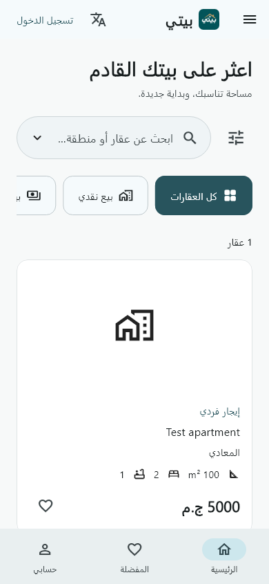
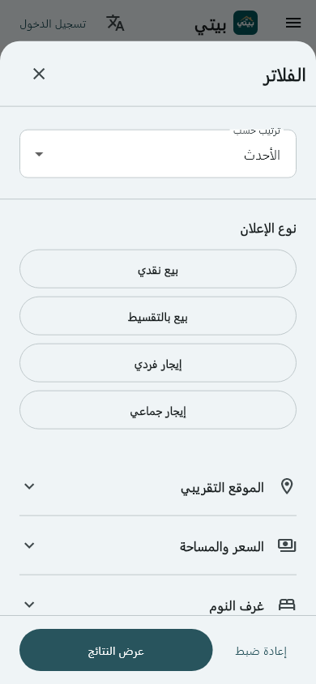
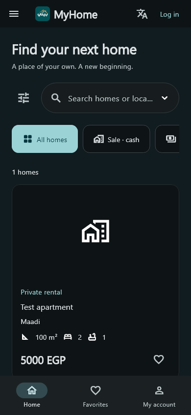

# بيتي | MyHome


تطبيق عقارات وسكن مشترك للسوق المصري، مبني بـ **Flutter + Cubit/BLoC** و**Python/FastAPI + PostgreSQL**، مع تشغيل محلي باستخدام Docker. يدعم العربية والإنجليزية، اتجاه RTL، والوضع الفاتح والداكن.

A real-estate and shared-housing marketplace for Egypt. Browse approved properties as a guest; sign in to view details, save homes or submit a listing.

| الرئيسية بالعربي | الفلاتر بالعربي | Dark mode |
|---|---|---|
|  |  |  |

Screenshots use synthetic test fixtures. The local application database is not seeded with these listings.

## الموجود حاليًا / Implemented

- صفحة رئيسية عامة، بحث نصي، فلاتر تفصيلية، ترتيب وترقيم صفحات من قاعدة البيانات. لوحة الفلاتر تطبق التغييرات عند الضغط على «تطبيق».
- تسجيل حساب ودخول وتجديد جلسة وتسجيل خروج، مع حماية تفاصيل العقارات والمفضلة.
- اختيار أكثر من غرض للمستخدم وتغيير الوضع النشط؛ تبويب شركاء السكن يظهر للمستأجر المشترك فقط، والصلاحيات تُفرض أيضًا على الخادم.
- نموذج إعلان بخطوات إلزامية للبيع النقدي والتقسيط والإيجار الفردي والمشترك، المحافظة والمنطقة والصور والمرافق والتشطيب.
- رفع إثبات الملكية والهوية بشكل خاص ومشفر، مقارنة رقم البطاقة وتاريخ الميلاد، OCR ومراجعة إدارية قبل النشر. OCR ليس نظام تحقق بيومتري أو ضمانًا لصحة الهوية.
- طلبات السكن المشترك وقبولها مع منع حجز آخر سرير بالتزامن، وصلاحيات إنشاء مجموعة واختيار مستأجر مقبول كمشرف.
- ترجمة عربية/إنجليزية، تفضيلات محفوظة، ودعم تقليل الحركة.

**لم يكتمل بعد:** مطابقة شركاء السكن، المحادثات والمكالمات المشفرة من الطرف للطرف، دورة تعديل/استئناف الإعلان كاملة، استعادة كلمة المرور، الإشعارات وخطط الاحتفاظ والنسخ الاحتياطي. المجموعات الحالية بيانات وصلاحيات فقط (`messagingReady=false`).

**Pending:** roommate matching, E2EE messaging/calls, complete listing edit/resume lifecycle, account recovery, notifications and production operations. This repository is an implementation in progress.

## التشغيل المحلي / Local setup

Requirements: Flutter/Dart compatible with [pubspec.yaml](myhome_flutter/pubspec.yaml), Python 3.11+, Docker Desktop with Linux containers. Android builds require the Android SDK; iOS requires macOS/Xcode.

From the repository root:

```powershell
python tools/setup_local.py
docker compose --env-file infrastructure/.env -f infrastructure/compose.yaml up -d --build api
```

The setup command creates random local credentials once and never overwrites an existing `.env`. Keep `DOCUMENT_KEY` together with private-media backups; changing or losing it prevents decryption. No secrets or real identity documents belong in Git.

```powershell
cd myhome_flutter
flutter pub get
flutter gen-l10n
flutter run -d chrome --web-port 8080
```

- API: `http://127.0.0.1:3000/api/v1`
- API documentation: `http://127.0.0.1:3000/api/docs`
- PostgreSQL: `127.0.0.1:55432`, database `myhome`
- Android emulator: the app selects `http://10.0.2.2:3000/api/v1` automatically.
- Other servers: `--dart-define=API_BASE_URL=https://your-server/api/v1`.

Docker binds to the development machine's loopback address. Physical devices need a reachable API and appropriate network/TLS configuration. Browser secure storage requires localhost or HTTPS.

Migrations run before the API starts; the API uses a restricted database role. Locations are preloaded. No administrator account or sample property is seeded. Operator setup, host Python development and isolated database tests: [local setup guide](docs/30_FASTAPI_LOCAL_SETUP.md).

## Structure

```text
myhome_flutter/   Flutter app: domain repositories, data adapters, Cubit/BLoC UI
backend_fastapi/  FastAPI, SQLAlchemy, Alembic migrations, PostgreSQL tests
infrastructure/   Local Docker Compose and database initialization
UI/              Original design references
design/branding/ Selected Arabic architectural logo, masters and proposal history
docs/            Requirements, audited progress, setup and screenshots
tools/           Local setup helper
```

The previous NestJS backend and unused Flutter placeholders were removed. Historical documentation remains for traceability; current FastAPI documents supersede old NestJS commands.

## Validation

```powershell
cd myhome_flutter
flutter analyze --no-pub
flutter test --no-pub
flutter build web --no-pub
flutter build apk --debug --no-pub
```

For the API, install `backend_fastapi/requirements-dev.txt` in a virtual environment and follow the [isolated PostgreSQL test instructions](docs/30_FASTAPI_LOCAL_SETUP.md#test). Tests refuse to use the application database. iOS, release signing and native device security/storage still require platform verification.

## Documentation & branding

- [Current requirements](docs/29_PRODUCT_REQUIREMENTS_2026_11_14.md)
- [Implementation progress](docs/05_IMPLEMENTATION_PROGRESS.md)
- [Build/test evidence and limitations](docs/25_BUILD_TEST_RESULTS.md)
- [Agent handoff](docs/14_AGENT_HANDOFF.md)
- [UI reference specifications](docs/07_UI_SCREEN_SPECIFICATIONS.md)
- [الشعار المعتمد وملفات الهوية / Selected brand assets](design/branding/README.md)

The product name is **بيتي** in Arabic and **MyHome** in English. The selected logo is the Arabic architectural wordmark (proposal 02), used throughout the app and platform icons.
