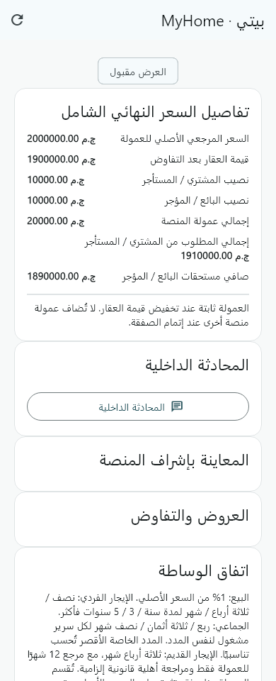
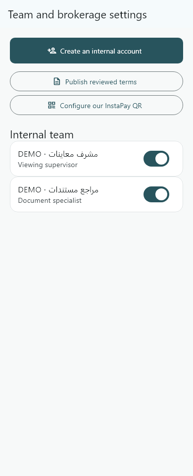
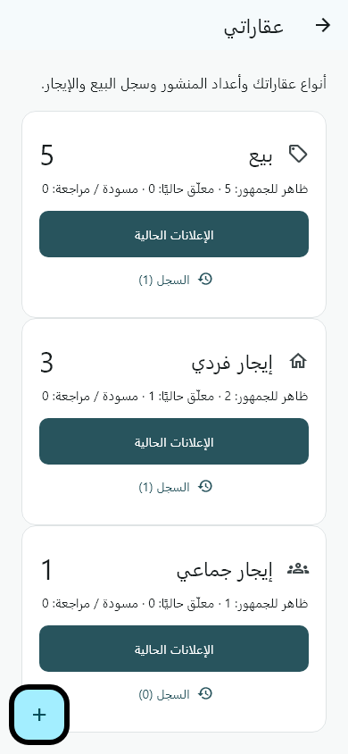
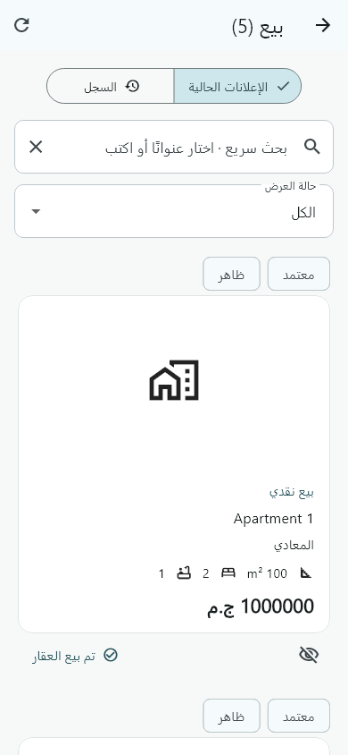

# بيتي | MyHome


تطبيق عقارات وسكن مشترك للسوق المصري، مبني بـ **Flutter + Cubit/BLoC** و**Python/FastAPI + PostgreSQL**، مع تشغيل محلي باستخدام Docker. يدعم العربية والإنجليزية، اتجاه RTL، والوضع الفاتح والداكن.

A real-estate and shared-housing marketplace for Egypt. Browse approved properties as a guest; sign in to view details, save homes or submit a listing.

| الرئيسية بالعربي | الفلاتر بالعربي | Dark mode |
|---|---|---|
|  |  |  |

Screenshots use synthetic test fixtures. The local application database is not seeded with these listings.

## الموجود حاليًا / Implemented

- صفحة رئيسية عامة، بحث نصي، فلاتر تفصيلية، ترتيب وترقيم صفحات من قاعدة البيانات. لوحة الفلاتر تطبق التغييرات عند الضغط على «تطبيق».
- صفحة «عقاراتي» بعدادات البيع والإيجار الفردي والجماعي، بحث باقتراحات من قاعدة البيانات، تحميل 3 عقارات في كل دفعة، إخفاء مؤقت وسجل بيع/تأجير. المفضلة تحتفظ بحالة الإعلان غير المتاح.
- تسعير نهائي شامل: عمولة البيع 1% من السعر الأصلي مناصفة، وتظل ثابتة بعد التفاوض. الإيجار حسب المدة؛ الإيجار القديم يحتاج مراجعة أهلية قانونية، و12 شهرًا مرجع للعمولة فقط. [القواعد والأمثلة](docs/35_ALL_IN_SUPERVISED_DEALS.md).
- رحلة صفقة بإشراف المنصة: حجز معاينة، مشرف داخلي، عروض وتفاوض، موافقة الطرفين على شروط الوساطة، مراجع مستندات، QR إنستاباي خاص بالمنصة وتأكيد تحويل تراجعه الإدارة بالسجل البنكي.
- محادثات نصية منفصلة للصفقة ولجروب السكن: فحص بيانات الاتصال على الخادم قبل الإرسال ثم تشفير للتخزين، وفق الاختيار المعتمد. ليست مشفرة من الطرف للطرف.
- تسجيل حساب ودخول وتجديد جلسة وتسجيل خروج، مع حماية تفاصيل العقارات والمفضلة.
- اختيار أكثر من غرض للمستخدم وتغيير الوضع النشط؛ تبويب شركاء السكن يظهر للمستأجر المشترك فقط، والصلاحيات تُفرض أيضًا على الخادم.
- أول دخول يبدأ باختيار مالك عقار أو مشتري/مستأجر وأنواع كل اختيار، دون تفاصيل عمولة. آخر خطوة لإضافة الإعلان تجمع السعر والمدة وحاسبة تلقائية لصافي المالك والسعر الشامل وحصص العمولة. [شرح الواجهات والحسابات](docs/37_ONBOARDING_AND_PRICE_CALCULATOR.md).
- نموذج إعلان بخطوات إلزامية للبيع النقدي والتقسيط والإيجار الفردي والمشترك، المحافظة والمنطقة والصور والمرافق والتشطيب.
- رفع إثبات الملكية والهوية بشكل خاص ومشفر، مقارنة رقم البطاقة وتاريخ الميلاد، OCR ومراجعة إدارية قبل النشر. OCR ليس نظام تحقق بيومتري أو ضمانًا لصحة الهوية.
- طلبات السكن المشترك وقبولها مع منع حجز آخر سرير بالتزامن، وصلاحيات إنشاء مجموعة واختيار مستأجر مقبول كمشرف.
- ترجمة عربية/إنجليزية، تفضيلات محفوظة، ودعم تقليل الحركة.

**لم يكتمل بعد:** مطابقة شركاء السكن، المكالمات، دورة تعديل/استئناف الإعلان كاملة، استعادة كلمة المرور، الإشعارات وخطط الاحتفاظ والنسخ الاحتياطي للإنتاج. الدفع الحالي بتأكيد إداري يدوي؛ لا يوجد ربط بنكي تلقائي أو توقيع إلكتروني معتمد. الإدارة تضيف شروطًا مُراجعة والـQR الحقيقي قبل التعاملات الفعلية.

**Pending:** roommate matching, calling, complete listing edit/resume UI, account recovery, notifications and production operations. Text is server-moderated and encrypted at rest. Payment claims require external bank reconciliation by an admin; recorded consent is not a certified signature. This repository is an implementation in progress.

## التشغيل المحلي / Local setup

**للتجربة من الموبايل أو إرسال رابط ويب:** افتح [Start_MyHome.cmd](Start_MyHome.cmd). يشغّل قاعدة التجربة والـBackend والويب ويعرض رابط HTTPS. للإيقاف افتح [Stop_MyHome.cmd](Stop_MyHome.cmd). لبناء APK متصل بالرابط الحالي استخدم `Start_MyHome.cmd -Android`. [شرح التشغيل والمتطلبات](docs/36_ONE_CLICK_DEMO.md).

**رابط Cloudflare الثابت:** [افتح بيتي](https://myhome.mohamed-fooda-mtf.workers.dev). الـWorker بوابة للويب والـAPI المحليين؛ يجب بقاء الكمبيوتر وDocker والإنترنت شغّالين. ملف التشغيل يعيد توصيله تلقائيًا بعد الربط الأول. لإعداد الربط أو إعادة نشره افتح [Deploy_Cloudflare.cmd](Deploy_Cloudflare.cmd)؛ يتطلب Node.js 22.12+ وجلسة Cloudflare مخوّلة. [التشغيل والحدود والرجوع](docs/38_CLOUDFLARE_WORKER.md).

Requirements: Flutter/Dart compatible with [pubspec.yaml](myhome_flutter/pubspec.yaml), Python 3.11+, Docker Desktop with Linux containers. Android builds require the Android SDK; iOS requires macOS/Xcode.

From the repository root:

```powershell
python tools/setup_local.py
docker compose --env-file infrastructure/.env -f infrastructure/compose.yaml up -d --build api
```

The setup command creates random local credentials once and never overwrites an existing `.env`. Keep `DOCUMENT_KEY` together with private-media backups; changing or losing it prevents decryption. No secrets or real identity documents belong in Git.

```powershell
cd myhome_flutter
flutter pub get
flutter gen-l10n
flutter run -d chrome --web-port 8080
```

- API: `http://127.0.0.1:3000/api/v1`
- API documentation: `http://127.0.0.1:3000/api/docs`
- PostgreSQL: `127.0.0.1:55432`, database `myhome`
- Android emulator: the app selects `http://10.0.2.2:3000/api/v1` automatically.
- Other servers: `--dart-define=API_BASE_URL=https://your-server/api/v1`.

Docker binds to the development machine's loopback address. Physical devices need a reachable API and appropriate network/TLS configuration. Browser secure storage requires localhost or HTTPS.

Migrations run before the API starts; the API uses a restricted database role. Locations are preloaded. No administrator account or sample property is seeded. Operator setup, host Python development and isolated database tests: [local setup guide](docs/30_FASTAPI_LOCAL_SETUP.md).

## Structure

```text
myhome_flutter/   Flutter app: domain repositories, data adapters, Cubit/BLoC UI
backend_fastapi/  FastAPI, SQLAlchemy, Alembic migrations, PostgreSQL tests
infrastructure/   Local Docker Compose and database initialization
UI/              Original design references
design/branding/ Selected Arabic architectural logo, masters and proposal history
docs/            Requirements, audited progress, setup and screenshots
tools/           Local setup helper
```

The previous NestJS backend and unused Flutter placeholders were removed. Historical documentation remains for traceability; current FastAPI documents supersede old NestJS commands.

## Validation

Current verification: **58 Flutter tests + 66 PostgreSQL API tests + 11 Worker tests**, 4 new onboarding/calculator preview-render tests, analyzer/Ruff clean, Web release and Android debug builds. [Onboarding/calculator evidence](docs/37_ONBOARDING_AND_PRICE_CALCULATOR.md). [Worker deployment and actual public HTTP checks](docs/38_CLOUDFLARE_WORKER.md). The existing deal/chat checks remain covered. iOS is not built on Windows; physical-device/browser GUI testing is not claimed.

## تجربة ببيانات منفصلة / Isolated demo

After starting PostgreSQL and installing backend development requirements:

```powershell
powershell -NoProfile -ExecutionPolicy Bypass -File tools/start_demo.ps1
cd myhome_flutter
flutter run -d chrome --web-port 8081 --dart-define=API_BASE_URL=http://localhost:3001/api/v1
```

The separate `myhome_demo` database contains 10 accounts (including admin, field agent and document reviewer), 13 synthetic properties, one housing group, an open deal and two real moderated conversations with encrypted storage. Random credentials and scenario results stay in ignored `artifacts/`; no known demo password is published. The main owner has 5 sale / 3 private-rental / 1 shared-rental current listings, plus history. The demo invents no real payment destination or legally approved terms. Run `python tools/smoke_demo.py` to check the Docker API. See the [current demo/operating guide](docs/35_ALL_IN_SUPERVISED_DEALS.md).

| السعر والعمولة | المحادثة الداخلية | إدارة الفريق |
|---|---|---|
|  |  |  |

| عقاراتي | بيع · بحث وتحميل تدريجي |
|---|---|
|  |  |

## Checks

```powershell
cd myhome_flutter
flutter analyze --no-pub
flutter test --no-pub
flutter build web --no-pub
flutter build apk --debug --no-pub
```

For the API, install `backend_fastapi/requirements-dev.txt` in a virtual environment and follow the [isolated PostgreSQL test instructions](docs/30_FASTAPI_LOCAL_SETUP.md#test). Tests refuse to use the application database. iOS, release signing and native device security/storage still require platform verification.

## Documentation & branding

- [Current requirements](docs/29_PRODUCT_REQUIREMENTS_2026_11_14.md)
- [Implementation progress](docs/05_IMPLEMENTATION_PROGRESS.md)
- [Build/test evidence and limitations](docs/25_BUILD_TEST_RESULTS.md)
- [Agent handoff](docs/14_AGENT_HANDOFF.md)
- [UI reference specifications](docs/07_UI_SCREEN_SPECIFICATIONS.md)
- [الشعار المعتمد وملفات الهوية / Selected brand assets](design/branding/README.md)

The product name is **بيتي** in Arabic and **MyHome** in English. The selected logo is the Arabic architectural wordmark (proposal 02), used throughout the app and platform icons.
