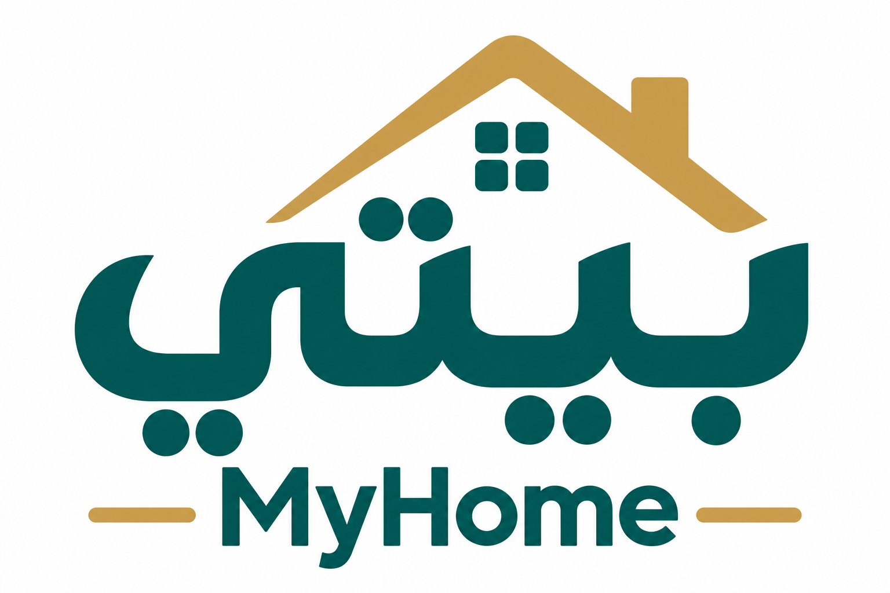

# بيتي · MyHome — logo proposals

**Selected: option 02 — Arabic architectural wordmark**, approved by the owner on 2026-11-14 and installed in the app. The other concepts remain as design history.



[App icon master](selected/app-icon-master.png) · [Production prompts](selected/prompts.json)

| Option | Direction | Preview |
|---|---|---|
| 01 | A welcoming home and heart · البيت والقلب | [View](proposals/logo-01-heart.png) |
| 02 | Arabic architectural wordmark · حروف عربية معمارية | [View](proposals/logo-02-arabic.png) |
| 03 | M / roof / open door · حرف M وباب مفتوح | [View](proposals/logo-03-monogram.png) |
| 04 | Shared homes / belonging · السكن المشترك | [View](proposals/logo-04-community.png) |

Generated with the built-in **imagegen** tool. The exact four prompts are preserved in [prompts.json](prompts.json).
The selected board was edited using built-in **imagegen** into a bilingual wordmark on white and a full-bleed square app icon. The wordmark uses a white presentation surface for readable colors in light and dark themes. A failed transparent extraction was discarded. The two accepted masters and exact final prompts are in `selected/`; the original proposal is retained.

Flutter assets are in `myhome_flutter/assets/branding/`. Android launcher/adaptive icons, iOS icons/launch artwork, Web/PWA icons, macOS icons and Windows ICO are packaged from these masters. Regenerate sizes on Windows with:

```powershell
powershell -NoProfile -ExecutionPolicy Bypass -File tools/generate_brand_icons.ps1
```

This script only resamples the approved raster masters into platform sizes. No generated asset references a user-profile path. Vector artwork and a transparent wordmark are not part of the installed set.
