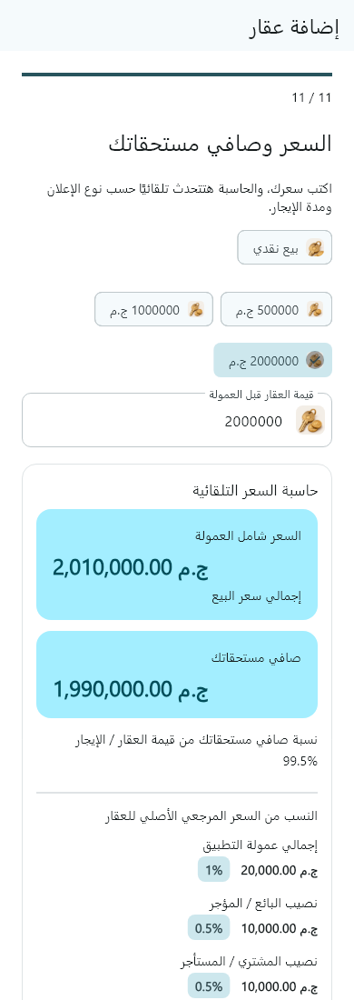

# اختيار المستخدم وحاسبة السعر في آخر خطوة — 2026-11-15

تحديث لاحق: [الدليل 39](39_VISUAL_LISTING_AND_OPEN_MAPS.md) يضيف الاختيارات المصوّرة والعنوان/الوصف التلقائي، ويجمع المرافق في خطوة واحدة ويضيف الخرائط المفتوحة والمساحة والفرش. السعر والحاسبة يظلان آخر خطوة، وقواعد العمولة لم تتغير.

تعديل حسب طلب صاحب المنتج: أول دخول لا يعرض تفاصيل الأسعار أو سياسة العمولة. هذا يلغي موضع عرض السياسة السابق في Onboarding؛ نسب العمولة المعتمدة وقواعد ثبات المرجع لم تتغير.

## أول دخول وإعدادات الأدوار

- اختياران واضحان: **مالك عقار** و**مشتري أو مستأجر**. يمكن اختيار الاثنين.
- المالك يحدد بيع نقدي، بيع بالتقسيط، إيجار فردي أو جماعي؛ الباحث يحدد شراء نقدي/تقسيط أو إيجار فردي/جماعي.
- لا تُعرض أنواع المجموعة قبل اختيارها، ولا تضاف صلاحيات ضمنية بمجرد اختيار «مالك». يجب اختيار نوع واحد على الأقل لكل مجموعة مختارة.
- وضع الاستخدام النشط يظهر عند وجود أكثر من اختيار، وتظهر صفة طالب/مغترب عند اختيار السكن الجماعي.
- إزالة مجموعة تزيل أنواعها من التحديد قبل الحفظ وتضبط الوضع النشط للاختيار المتبقي. صلاحيات الـBackend لم تتغير.

## آخر خطوة في إضافة العقار

الترتيب الحالي: نوع الإعلان → بيانات وموقع ومساحة ومرافق وتشطيب → أسرة السكن الجماعي عند الحاجة → صور → إثباتات الهوية/الملكية → مراجعة بيانات العقار → **السعر وصافي مستحقاتك**.

لا توجد معاينة عمولة في صفحة الأسرة أو الإثباتات أو مراجعة البيانات، حتى عند الرجوع من خطوة السعر. الخطوة الأخيرة تجمع:

- السعر قبل العمولة، بوحدة واضحة للبيع أو الإيجار الشهري أو السرير شهريًا.
- مدة الإيجار من قائمة سنة / 3 / 5 / قديم / مدة مخصصة بالشهور.
- حاسبة تلقائية بعد إدخال/تعديل المبلغ أو المدة، دون زر منفصل للحساب.
- السعر الشامل المعلن، صافي المالك، إجمالي عمولة التطبيق، وحصة كل طرف بالمبلغ والنسبة.
- تحديد قابلية الفصال، التأمين المنفصل، ومدخلات التقسيط عند انطباقها. كلها تبقى إلزامية حسب نوع الإعلان.
- تفاصيل الحسبة وسياسة العمولة داخل قسم قابل للفتح في آخر خطوة. الموافقة الملزمة على الوساطة تظل في مسار الصفقة قبل الالتزام المالي.

زر إرسال الإعلان لا يتفعّل حتى تصل حسبة سارية من الخادم. تعديل السعر يمسح النتيجة القديمة ويعيد الحساب؛ النتيجة المتأخرة لطلب سابق لا تستبدل الأحدث. فشل الاتصال يتيح إعادة الحسبة. التأمين والفصال لا يلغيان حسبة سارية لأنهما لا يغيران العمولة.

## مصدر المبالغ والنسب

`backend_fastapi/app/financial.py` ما زال المصدر الوحيد للحسابات. Flutter ينسّق العرض فقط، بما فيه فواصل الآلاف واتجاه الأرقام والنسب في العربية، دون حساب رسوم مستقل.

إضافة استجابة `calculator` لا تغيّر أي مبلغ مالي محفوظ:

- البيع: النسب من السعر المرجعي الأصلي؛ 1% إجماليًا، 0.5% لكل طرف.
- الإيجار محدد المدة: نسب العمولة المعروضة من الإيجار المرجعي الإجمالي للمدة المختارة. مثلًا نصف شهر من إيجار سنة يساوي نحو 4.1667% من إجمالي الإيجار السنوي، مناصفة بين الطرفين.
- الإيجار القديم: النسب من شهر الإيجار المرجعي، لا من مدة عقد مفترضة. ¾ شهر يساوي 75% من إيجار شهر، مناصفة. مرجع 12 شهرًا وقيد الأهلية القانونية السابقان باقيان.
- صافي المالك كنسبة يكون من قيمة العقار/الإيجار الحالية قبل العمولة؛ أما نسب العمولة فتظل من المرجع الأصلي. الخصم لا يعيد حساب مبالغ العمولة.
- مبالغ الإيجار الشهرية صافي متوسط بعد توزيع حصة العمولة لمرة واحدة على المدة، وليست ادعاء خصم بنكي شهري آلي.
- السكن الجماعي يُحسب لكل عقد سرير؛ عدد الأسرة لا يضاعف عمولة الفرد تلقائيًا.

مثال البيع: إدخال 2,000,000 يعرض للمشتري 2,010,000، وصافي المالك 1,990,000، وإجمالي المنصة 20,000. تعديل سعر إعلان محفوظ أو التفاوض يلتزمان بالمرجع المثبت السابق.

## التحقق

- 58 اختبار Flutter، منها اختيار المجموعات وتعدد الأدوار وإزالتها، واجهات AR/EN عند 320 و1440 بكسل، مدة الإيجار والحسبة المتغيرة، الأرقام العربية، إعادة المحاولة والردود المتأخرة.
- 66 اختبار PostgreSQL/Backend، بما فيها نسب الحاسبة للبيع والتقسيط والإيجار 1/3/5 سنوات والجماعي والقديم، وثبات نسب المرجع بعد التفاوض.
- Analyzer وRuff سليمان. Web release وAndroid debug مبنيان، والحاويات المحلية محدثة. لم تتغير قاعدة البيانات أو migrations.
- 4 اختبارات render جديدة، تشمل العربية والإنجليزية والوضعين، مع مراجعة صور `roles*.png` و`pricing-*.png` بصريًا.
- الأدلة المحلية: `artifacts/calculator-flutter-tests.log` و`calculator-backend-tests.log` و`calculator-previews.log` و`calculator-launcher-build.log`.

| اختيار المستخدم | السعر النهائي والحاسبة |
|---|---|
|  |  |
