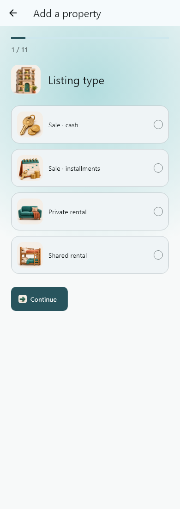

# إضافة العقار المصوّرة والخرائط المفتوحة — 2026-11-15

هذا التحديث يجمع طلب إصلاح «استمرار» وإضافة العقار للقائمة الجانبية، مع طلب المناطق والخرائط والمساحة والمرافق والفرش والصور والخلفيات. يحل محل ترتيب الخطوات القديم، ويحافظ على التسعير النهائي والصفقات والصلاحيات السابقة.

## رحلة الإعلان

- المالك يصل إلى «إضافة عقار» من القائمة الجانبية أو الزر الرئيسي. ظهور الاختصار حسب الأغراض المختارة؛ صلاحيات الإنشاء تظل مفروضة في FastAPI.
- اختيار نوع الإعلان ثم نوع العقار بكروت مصوّرة. يتكوّن عنوان ووصف من الإجابات الفعلية، دون اختلاق مرافق أو وعود. الكتابة اليدوية بديل اختياري. سبب توقف الصورة المرسلة كان وصفًا أقصر من 20 حرفًا؛ الآن يظهر السبب المحدد تحت الحقل وفي الخطوة، ويمكن تصحيحه والمتابعة.
- المحافظة والمنطقة من الكتالوج. قائمة المنطقة قابلة للتمرير والبحث الاختياري، وتظهر المنطقة الأم مع الشياخة عند الحاجة للتمييز.
- المساحات الشائعة تتضمن 85 و95 و115 مترًا، مع إمكانية إدخال مساحة دقيقة. اختيار صافي داخلي أو إجمالي شامل المناور والسلالم إلزامي في الواجهة الجديدة.
- عدد الغرف والحمامات باختيارات وعدّادات؛ عدد الأفراد يظهر ويُطلب للسكن الجماعي فقط، ويُستبعد من باقي واجهات الإعلان والمراجعة والتفاصيل. القيم القديمة محفوظة للتوافق ولا تُعرض كادعاء بعدد السكان.
- المياه والكهرباء والغاز في صفحة واحدة، وكل إجابة نعم/لا مطلوبة صراحةً. لوكس وسوبر لوكس يعرضان سؤال الفرش؛ لا يظهر مع الطوب أو المحارة، وتُستبعد إجابته غير المنطبقة.
- الصور ثم إثباتات الهوية/الملكية ثم المراجعة، وأخيرًا السعر والحاسبة فقط. مدة الإيجار وعدد الأقساط لهما اختيارات دون كتابة؛ تبقى الكتابة للمبالغ الدقيقة والرقم القومي والتفاصيل الاختيارية. تاريخ الميلاد من تقويم.

## الموقع بدون خدمات مدفوعة

FlutterMap 8.3.2 مع طبقة سحب الدبوس المفتوحة المصدر، ونموذج `PropertyLocation` ومستودع `LocationRepository` و`LocationPickerCubit`. التطبيق لا يستخدم Google Maps API أو Google Cloud Billing أو خدمة geocoding/routing مدفوعة.

- يمكن الضغط على الخريطة ثم سحب الدبوس وتأكيد المكان. مركز العرض الافتراضي ليس موقعًا محفوظًا للعقار.
- «موقعي الحالي» وحده يطلب إذن الجهاز؛ رفض الإذن لا يمنع الاختيار اليدوي ولا يمسح الدبوس السابق. يلزم وجود المستخدم في العقار لاستخدام موقعه كعنوان للعقار. أذونات Android وشرح iOS بالعربية والإنجليزية مضافان؛ لا يُطلب تتبع في الخلفية.
- الإحداثيات مخزنة مستقلتين في حقلي PostgreSQL الموجودين، بدقة 7 خانات عشرية، ومتحقق منهما على العميل والخادم داخل حدود مصر. أزيلت حقول كتابة خط الطول والعرض من الواجهة والمراجعة.
- يمكن لصق رابط مشاركة OpenStreetMap أو Google Maps. يُحلَّل النص محليًا دون الاتصال بخدمة Google. الروابط الطويلة ذات الإحداثيات تُلحق الدبوس؛ الرابط المختصر أو الذي يحتوي اسم مكان فقط يُحفظ كرابط مع طلب اختيار الدبوس، دون تخمين موقع أو فتح وجهة HTTP يرسلها المستخدم.
- تفاصيل العقار تعرض خريطة الموقع المحفوظ؛ الرئيسية تتيح خريطة بدبابيس **نتائج الصفحة الحالية** فقط. العقار بلا موقع محفوظ لا يُمنح موقعًا افتراضيًا. فتح تفاصيله يظل خاضعًا لتسجيل الدخول.
- تعذر تحميل صور الخريطة يعرض رسالة و«إعادة المحاولة»، ويحتفظ بالمكان السابق ويمنع اختيار نقطة من خلفية فارغة. يبقى اختيار موقع الجهاز ولصق رابط متاحين.

## مصدر الخرائط وسياسة الاستخدام

الإعداد الافتراضي مصدر HTTPS القياسي لصور OpenStreetMap. الإسناد المرئي «© OpenStreetMap contributors» خارج طبقات الخريطة حتى لا تغطيه رسالة الخطأ. Native يرسل تعريف التطبيق، والويب يستخدم Referer المتصفح؛ ضُبطت البوابة والـWorker على `strict-origin-when-cross-origin`.

FlutterMap يستخدم التخزين المؤقت المدمج بحسب رؤوس HTTP، والمتصفح يستخدم تخزينه الطبيعي. لا تُرسل طلبات الصور مع رؤوس منع الكاش، ولا يوجد تنزيل جماعي أو prefetch/offline download؛ `panBuffer: 0`. الخدمة العامة best effort وليست استضافة تجارية مجانية غير محدودة أو ذات SLA. [سياسة OSM الرسمية](https://operations.osmfoundation.org/policies/tiles/) و[توثيق كاش FlutterMap](https://docs.fleaflet.dev/getting-started/new-in-v8) هما مرجع التشغيل.

يمكن للإدارة التشغيلية تغيير مصدر XYZ إلى مصدر متوافق أو خادم ذاتي عبر `MAP_TILE_URL` و`MAP_ATTRIBUTION` و`MAP_ATTRIBUTION_URL` في إعداد البيئة، وإعادة تشغيل API، دون إعادة بناء التطبيق. `/locations/map-config` يزوّد الخرائط بالضبط الحالي. لا حاجة إلى مفتاح مدفوع، وتكاليف استضافة خادم ذاتي إن استُخدم تبقى على المشغّل.

## كتالوج المحافظات والمناطق

تم استيراد **365 مركزًا/قسمًا و5,716 شياخة/قرية** من نسخة مثبتة من [Open Admin Data](https://github.com/open-admin-data/egypt-administrative-divisions)، بإجمالي 6,081 سجلًا إضافيًا يغطي الـ27 محافظة. تاريخ المصدر 2026-09-08، والـcommit مثبت في `app/data/egypt-areas-source.json`. الترخيص CC BY 4.0 محفوظ بجانب البيانات، مع الإسناد في قائمة المناطق.

حُفظت معرفات المشروع القديمة مثل `maadi`؛ السجلات الجديدة لها بادئة `oad-`، دون حذف أو إعادة ربط أي إعلان. المصدر مجتمعي للتقسيمات الإدارية، وليس حصرًا مضمونًا لكل اسم شعبي أو كمبوند أو تقسيم جديد. يظل الوصف الاختياري والدبوس متاحين للمواقع الأدق. لم تُستورد مراكز المناطق كأنها مواقع عقارات.

## الصور والثيم

كانت بطاقة المالك تحجب الغلاف عندما يكون الإعلان مسودة أو قيد المراجعة، ثم تعتمد على مسار صور عام يشترط الاعتماد. استجابة المالك الآن ترفق الغلاف مع `cover_private: true`، و`PropertyPhoto` يحمّله عبر طلب مصادق عليه من المستودع. الصور غير المعتمدة لا تصبح عامة؛ وصول مستخدم آخر للمسار الخاص يظل 404.

الخلفية مستوحاة من `UI/ui .jpeg`: تدرّج ناعم أعلى الصفحة يذوب في الخلفية، بالألوان البترولية الحالية والوضعين. طُبّقت عبر `AppBackdrop` على التطبيق. أضيفت صورتا atlas محليتان بـ32 رسمة ملوّنة، واستُبدلت رموز التطبيق المكتوبة بمكوّن `AppImageIcon` مع حفظ الحالات والاتجاه وشفافية التعطيل. عناصر النظام القياسية مثل مؤشر التحديد وأزرار المتصفح الأصلية لا يعاد رسمها. [مصادر الصور والـprompts](../design/illustrations/README.md).

## البيانات والتحقق

Migration `20261116_listing_details` يضيف `area_measurement` و`furnished` و`location_url` كحقول قابلة لعدم المعرفة للإعلانات القديمة، ويجعل capacity قابلة للغياب خارج السكن الجماعي، ويستورد الكتالوج بإدراج لا يستبدل المعرفات. لا تخمين لصافي/إجمالي أو فرش الإعلانات السابقة. الواجهة الجديدة تطلب الإجابات المنطبقة؛ الـAPI يبقي القيم المفقودة مقبولة للعملاء/السجلات السابقة. أخذت نسخة احتياطية خاصة من main/demo قبل التطبيق؛ لا حذف للـvolumes أو إعادة تهيئة للحسابات.

- 78 اختبار Flutter و80 اختبار PostgreSQL و11 اختبار Worker ناجحًا؛ analyzer وRuff سليمان.
- تغطي الاختبارات تصحيح وصف قصير، الوصول من القائمة، استكمال البيع والجماعي بالعربية والإنجليزية، دقة الإحداثيات وحفظها، سحب الدبوس الحقيقي، رفض الإذن، فشل صور الخريطة، وصور المالك الخاصة.
- 8 اختبارات render للواجهات والحاسبة بالعربية والإنجليزية والوضعين. صور المراجعة `illustrated-*.png` و`roles-*.png` و`pricing-*.png` في `docs/screenshots/` تستخدم بيانات صناعية.
- Web release وAndroid debug عبر ملف التشغيل، وتحديث Worker الثابت، وفحوص HTTP فعلية موثقة بالسجلات المحلية في `artifacts/`. Windows/iOS/macOS لم تُبنَ؛ الرنرز محفوظة وحزم الخرائط المختارة تدعم Windows وAndroid وiOS وWeb. لا ادعاء اختبار GPS على هاتف فعلي أو GUI متصفح.
- النشر النهائي للـWorker: `5eb38ba9-0ef8-4842-9b4a-2bbecddac5c1`. `open-maps-public-smoke.json` يثبت تطابق ملف الويب العام مع البناء، وسياسة Referer، وكتالوج المحافظات، وتحليل رابط الموقع، وتحميل صورة اختبار صناعية خاصة غير ملحقة بإعلان مع منع عرضها العام. فحوص login/chat/isolation السابقة نجحت أيضًا. تم تجاوز خطأ اتصال Cloudflare مؤقت بإعادة محاولة محدودة؛ تحديث ملفات Flutter وحده لم يعد يعيد رفع كود البوابة.

الأدلة: `maps-flutter-tests.log`، `maps-backend-tests.log`، `map-widget-tests.log`، `maps-analyze.log`، `maps-previews.log`، `maps-main-deploy.log` و`maps-final-publish.log`. رابط التجربة يظل https://myhome.mohamed-fooda-mtf.workers.dev؛ الكمبيوتر وDocker والإنترنت يجب أن يظلوا شغالين.

| نوع الإعلان | المساحة والاختيارات |
|---|---|
|  |  |
