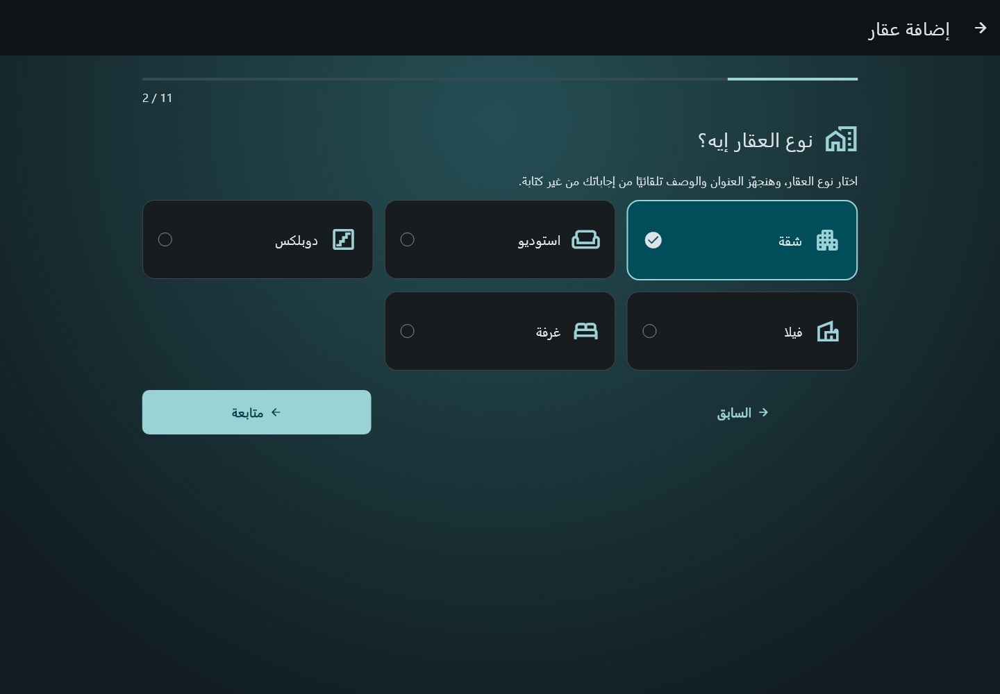
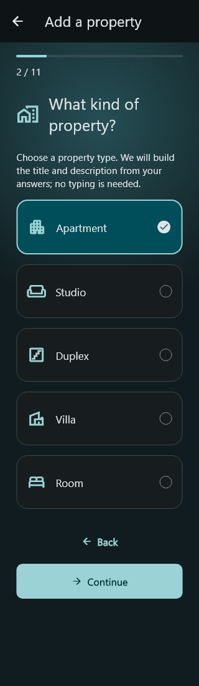
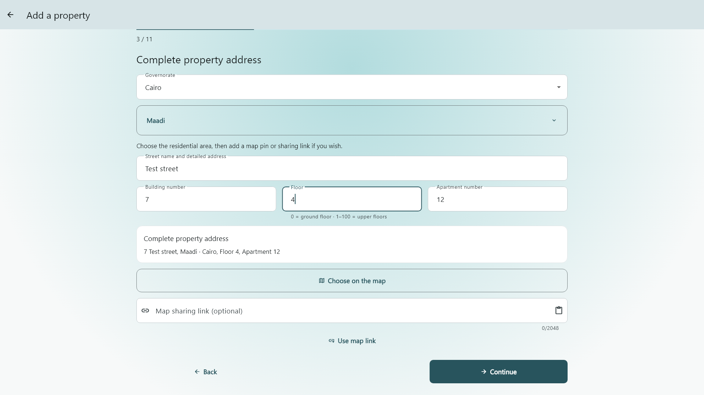
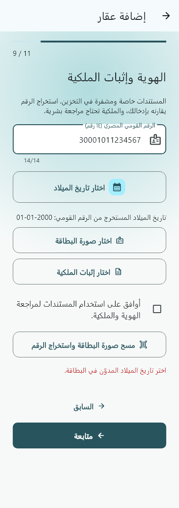

> Owner correction 2026-11-16: [Guide 41](41_PICTURE_SELECTION_AND_FURNISHING_FILTER.md) supersedes the blanket native-only picture policy and side check/radio selection feedback described here. Responsive widths and manual-copy removal remain current.

# Responsive layout and meaningful icons

Verified increment: 2026-11-16. This supersedes the previous requirement to replace every native icon with a raster picture. The existing teal gradient, light/dark themes, genuine property photos and app branding are retained.

## Listing behavior

The information step contains only the five property types. The manual title/description switch, inputs, translation keys and state flag are removed. `updateGeneratedDetails` always creates copy from the chosen type, transaction, area and later answers. It updates before advancing/submission; existing API validation is preserved. No extra copy-editing mode or duplicate preview appears here. The normal final review and final-step pricing calculator remain.

## Shared responsive design

`AppLayout` defines viewport-relative frames and readable upper bounds. `AppScaffold` uses a native Scaffold and constrains its body; keyboard handling, navigation, drawer, scrolling and safe areas remain native. All authored app screens use this shared frame. Authentication keeps a narrower reading width; marketplace results have a larger content frame.

| Element | Narrow viewport | Desktop (1100px+) |
|---|---|---|
| Form frame | Up to 96% of viewport | 76%, capped at 1240px |
| General content | 96%, capped at 1660px | Same cap |
| Minimum filled/outlined action height | 56px | 64px |
| Listing choice minimum height | 84px | 112px |
| Choice grid | One/two columns as space permits | Two/three columns |
| Listing navigation | Stacked below 360px available width | Each action uses 32% of available form width |

The theme scales text as well as padding, controls and toolbar heights. OS accessibility text scaling is still respected. Long content scrolls normally instead of being forced into a fixed screenshot height. A fixed-height drawer header was replaced with intrinsic content, and a compact guest sign-in glyph avoids crowding the language control on small screens. Property-cover height is bounded so widening a card does not create an excessively tall image.

## Icons and images

`AppIcon` delegates to Flutter's native Icon: foreground/disabled colors, semantics and direction follow the enclosing widget. `FeatureSymbol` provides a meaningful distinct icon for each structured answer (apartment, studio, duplex, villa, room, utilities and finishing). Unknown decorative mappings are omitted. Numeric presets do not repeat picture avatars; yes/no options use selection feedback rather than duplicate feature pictures. The location step no longer repeats the same selected area and map picture in several rows.

The language control uses `translate_rounded` and shows the destination language. On narrow screens the language label is shortened while the translation glyph remains visible. Navigation arrows retain RTL behavior. Identity input, identity upload, ownership document and birth date use their corresponding symbols.

The original two generated atlases are archived unchanged in `design/illustrations/masters/` with prompt history in its README, outside the runtime asset bundle. `property_illustration.dart` and its crop/decode test are removed. No raster modification or new image generation was needed. Real property photography and selected branding still use image assets normally.

## Verification

- `flutter analyze --no-pub`: clean.
- `flutter test --no-pub`: **87 passing** regression tests, including ten new responsive/language/accessibility checks. Existing sale/shared-rental upload/submission flows still pass in Arabic and English.
- `flutter test test/render_responsive_layout.dart --no-pub --update-goldens`: **4 passing** renderer scenarios, producing 16 screenshots. They cover home, property type, location and empty verification forms at 320/390/1440/1920px, both languages and both themes. These are Flutter widget renders, not browser or physical-device screenshots.
- Layout tests assert manual controls and raster images are absent from the information step, type icons are distinct, desktop widths/control heights grow, and narrow text scaling fits. Owner portfolio hide/search test settles scroll-triggered list layout before interaction.
- No backend, database, financial-policy or map-service changes in this increment. The preceding baseline has 80 PostgreSQL and 11 Worker checks; they are historical verification, not rerun for this UI-only change. Migration head remains `20261116_listing_details`; existing user data is preserved.

| Desktop Arabic dark | Mobile English dark |
|---|---|
|  |  |

| Location desktop | Verification mobile |
|---|---|
|  |  |

## Build and deployment

The authorized delivery uses `Start_MyHome.cmd -Android -NoBrowser` to build Web release and Android debug APK and reconnect the existing Cloudflare gateway. Web release and Android debug builds passed. `artifacts/MyHome-demo.apk` uses the stable Worker API. The gateway was already up to date; no redundant Worker deployment was needed. Public HTTP verification matched the served JavaScript SHA-256 to the local build, exercised authenticated login/logout, independent map-link coordinates and private owner photos, checked the 27-governorate/6,081-source-area catalogue, and confirmed private paths return 404. Both local APIs and the shared Web service are healthy. Build/runtime logs are retained in ignored `artifacts/layout-refinement-publish.log` and `artifacts/layout-refinement-public-smoke.log`. The stable URL is https://myhome.mohamed-fooda-mtf.workers.dev. This Worker forwards to the locally running demo: keep the PC, Docker and internet on. Current backend permission, private-photo and public-path checks are exercised against the deployed bundle. No iOS/desktop-native build or physical GPS/browser GUI test is claimed.

Logs and credentials stay under ignored `artifacts/`; screenshots contain synthetic fixtures and no identity documents. Remaining roadmap items in the master plan are still pending.
