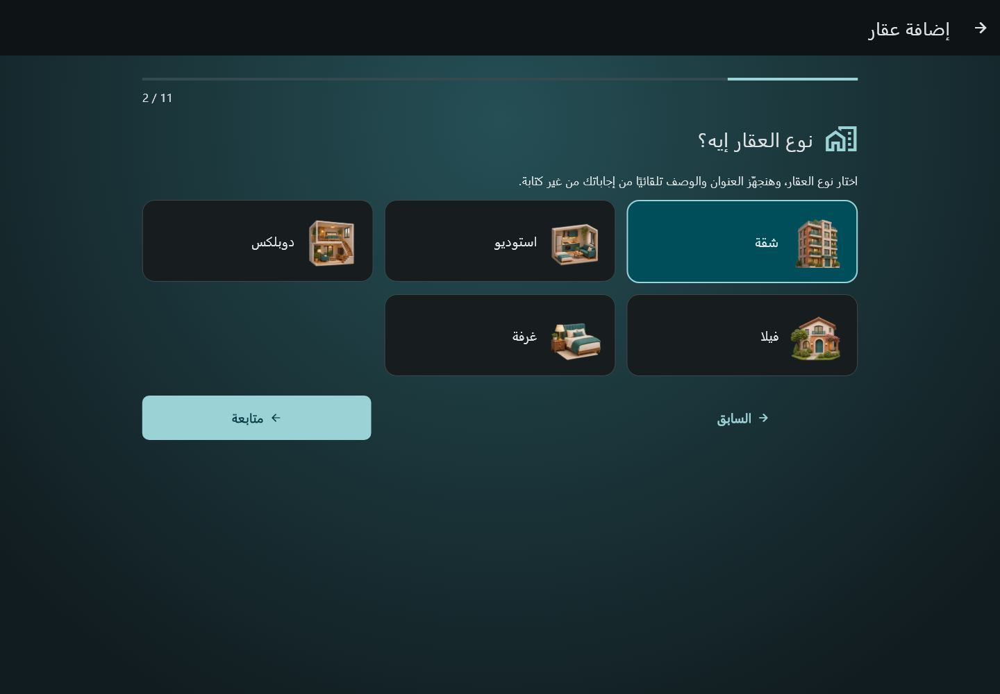
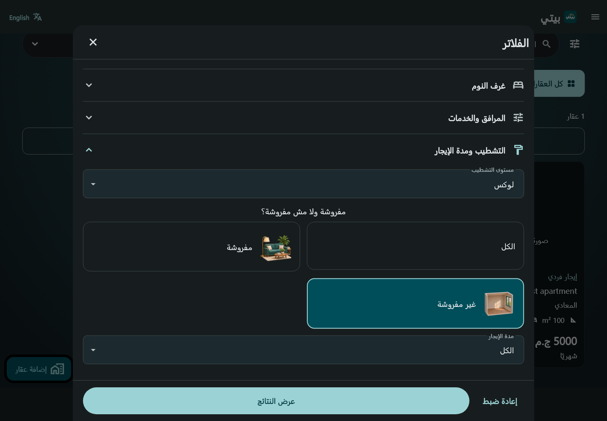
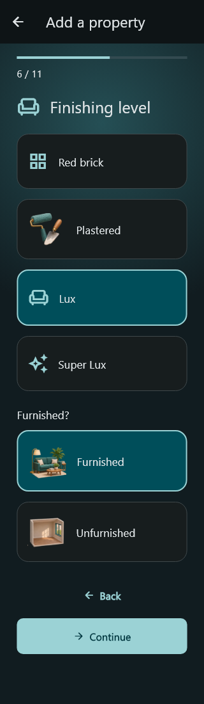
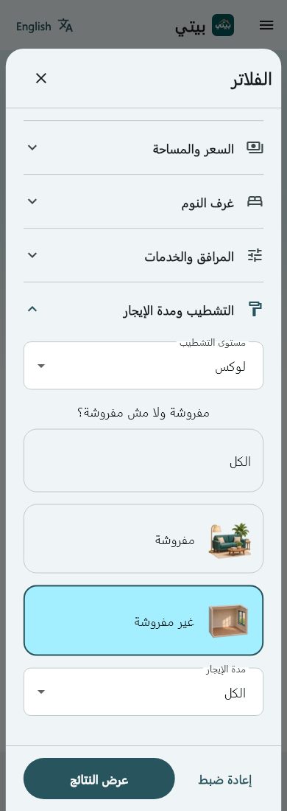

# Picture selection and furnishing search

Increment: 2026-11-16. This corrects guide 40's blanket native-only presentation while retaining its responsive sizes and removal of manual listing title/description.

## Search behavior

In the finishing/rental-duration filter section, choosing Lux or Super Lux reveals All / Furnished / Unfurnished cards. The furnished lounge and empty-room pictures are distinct and transparent. Changing to plastered, red brick or All finishing removes and clears the furnishing draft. Changing between Lux and Super Lux keeps it. Apply submits the draft; dismissing the sheet discards changes, and Reset clears the furnishing condition with the other filters.

`GET /api/v1/properties?furnished=true|false` applies a parameterized SQLAlchemy condition to the existing discovery query. It combines with finishing, transaction, rental duration, location and price filters. Approved/active listing, active verified owner and owner-intent restrictions are unchanged. `False` matches explicit false, never NULL; leaving the filter out includes old records with unknown furnishing. Invalid boolean values return 422. The existing nullable column is reused without a migration or rewriting legacy data.

## Selection and pictures

`SelectionTile` is one shared whole-card control for property choices, onboarding and document/financial acknowledgements. Pressing toggles the relevant state. Selected background and border, hover/focus feedback and accessibility selected/enabled semantics remain; there is no side checkbox, radio circle or check mark. Authored Checkbox/CheckboxListTile widgets are removed; chips and portfolio segments suppress their check indicators too. Confirmation-action icons and recorded status text remain meaningful actions/statuses.

Financial acknowledgements start unselected. Hover/focus never grants consent; the user must press the card and then the existing confirmation action. Current terms-digest gating, busy-state disabling, backend permissions and recorded consent checks are preserved. A card can be toggled off before submission.

`ChoiceArtwork` restores distinct transparent raster miniatures for apartment, studio, duplex, villa, bedroom, cash/installment sale, private/shared rent, furnished/unfurnished, utilities and document consent. Property types no longer reuse the same apartment picture. Utilities display their picture once beside the group title, rather than repeating it on yes/no answers. Native search, translation, arrows and other tool icons remain native. Numeric and yes/no options avoid artificial duplicate imagery. Small picture cards stack image/text when needed; responsive widths/control heights from guide 40 stay in use.

Actual property photos retain their existing public/private loading paths. When no photo is attached, a representative illustration is explicitly labeled as an illustration, rather than presented as a property photograph. Failed real image loads still have their existing error state.

Artwork: `myhome_flutter/assets/illustrations/choice-atlas-v2.png`, generated with the built-in image_gen tool and copied unchanged. It retains real alpha; there are no ivory tile backgrounds. [Final prompt, provenance and usage](../design/illustrations/CHOICE_ARTWORK_V2.md). Earlier masters stay archived. The app clips logical cells and excludes neighboring-row edge pixels at display time; no raster editor or paid API was used.

## Verification

- Flutter regression suite: 93 tests, including four AR/EN Lux/Super Lux filter cases, eight responsive type-picture cases, toggle/alpha tests and explicit financial-acknowledgement regression.
- PostgreSQL regression suite: 86 passed. Six added furnishing cases cover both finishes and sale/private/shared rent, true/false/unknown, draft/paused exclusion, combined duration/finishing and invalid input. All original financial/role/map/media checks remain in the suite.
- Flutter analyzer and Ruff: clean on final verification.
- Four renderer scenarios cover Arabic dark desktop 1440px, English light desktop 1920px, Arabic light mobile390px and English dark mobile320px; 24 synthetic screenshots include home, filter, type, location, furnishing and empty verification forms. These are widget renders, not browser GUI or physical-device captures.
- Web release and Android debug builds passed; the APK contains the exact new artwork bytes. Both main/demo APIs are healthy after rebuilding. Public HTTP smoke matched both the JavaScript bundle and PNG to local SHA-256 values, verified the new furnishing query responses, and rechecked auth/logout, private-photo protection, catalogue, map-link coordinates and private-path 404s. Existing public demo listings have unknown furnishing; explicit furnished/unfurnished combinations currently return zero there. Positive and unknown-result cases are tested on real isolated PostgreSQL fixtures, without inventing values for demo/user records. No native iOS/desktop or physical GPS test is claimed. No new map provider, paid API, financial policy or database migration.

| Property pictures | Furnishing filter |
|---|---|
|  |  |

| Narrow furnishing cards | Mobile filter |
|---|---|
|  |  |

## Delivery

The stable Worker gateway is https://myhome.mohamed-fooda-mtf.workers.dev. It forwards to the local demo Web/API; keep PC, Docker and internet running. `Start_MyHome.cmd -Android -NoBrowser` builds Web and the debug APK and reconnects it. Main/demo backend, Web release and APK are updated. The Worker gateway was already current and was reused. Evidence: ignored `artifacts/choices-{analyze,tests,backend-tests,render,main-api,publish,public-smoke}.log` and `picture-choices-public-smoke.json`; private logs, credentials and the APK remain ignored under `artifacts/`. Existing data is preserved. This increment does not mark the remaining marketplace roadmap complete.
