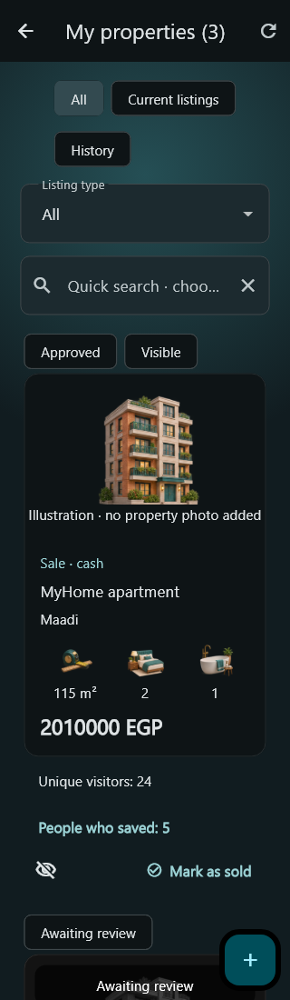

# Structured addresses, property details and owner engagement

Increment: 2026-11-16. This builds on guide 41 and preserves the approved financial rules, moderated encrypted-at-rest chat, open maps, private documents, property photos and structured choices.

## Address entry and credits

Creating/editing a listing now requires street/detailed address, building number, floor (-5 through 100, including ground floor zero), apartment/unit number and property type. Fields have independent database columns and server validation. The location step has no optional detailed-address switch. Its live preview combines building/street, chosen residential area, governorate, floor and unit. Building/floor/unit share a row on desktop and stack on mobile. Maps and pasted sharing links remain optional.

The backend composes and persists the canonical complete address from the saved columns and area catalogue, with Arabic and English display variants. The precise address is shown in authenticated details; public cards still show the area. Existing records retain their known address text and NULL structured fields; no street, floor or unit is fabricated. Existing records can be read without validating them against the new creation form. Editing them requires completing the address.

The Open Admin Data footer is removed from the residential-area picker. Its source link, CC BY 4.0 license link and modification notice are available in About under area-data credits; original attribution files remain bundled. OpenStreetMap attribution remains on the maps.

## Property details and pictures

The listing-details page shows the final advertised buyer/tenant price and the Buy / Rent property and Contact owner actions. It no longer renders the full financial ledger or commission breakdown there. Exact fees, reference-price guarantees and explicit agreement remain available in the existing deal, offer, confirmation and financial screens before commitment. Financial equations are unchanged. Old-rent eligibility still blocks financial commitment until reviewed.

Contact owner opens a property-specific conversation independently of a purchase deal or financial commitment. Buy/Rent starts the existing supervised deal flow when the account has the appropriate intent; otherwise the existing account-intent settings are opened. Saving clearly explains that the owner can see the account name and message inside the app, while email and phone remain private.

Property facts are responsive cards with matching transparent pictures, then label and value underneath. Property type, transaction, dimensions, net/gross, furnishing, utilities, lift and rental duration retain their meaning. Shared occupancy/bed counts only appear where applicable. Generated listing review uses the same card system. Selection-card captions always sit below the illustration, including desktop; the old optional side-by-side mode is removed. An extra transparent atlas supplies missing fact/finish/lease pictures so a picture grid does not fall back to mixed native glyphs. Native tool icons remain for arrows/search/chat and other controls.

Real property photos retain existing public/private loaders. Swipe and previous/next carousel buttons support navigation; page indication and reduced-motion behavior are preserved. Details enter with a short fade/translation, disabled when the OS requests reduced motion. Missing photographs use an explicitly labeled illustration and a smaller placeholder area.

[Artwork path, final prompt and built-in generation provenance](../design/illustrations/PROPERTY_FACTS_V3.md).

## My properties and statistics

The drawer shortcut opens the newest listings directly, rather than a category-selection landing page. Its initial scope includes all categories and all states. Exactly three rows are fetched per signed cursor page, ordered by created_at then ID descending; scrolling loads the next three. Existing category, quick-title search, current/history and availability filters remain. Paused, pending/review and sold/rented listings have grayscale cards and a clear state banner; owners still see their protected media. Existing pause/restore/closure rules and backend guards are preserved.

Owner-only counts per listing show unique authenticated visitors (excluding owner/admin and repeated views from the same account) and active accounts currently saving the property (excluding self-saves). Anonymous users cannot open details and are not counted. Historical view counts begin with this increment; old visits are not invented. No visitor identities are exposed.

The current savers list exposes only account ID and name to the listing owner. It uses 20-row cursor pagination; the owner can open an app conversation with a current saver. Removing a favorite removes that account from the list. Existing conversations remain readable by their two participants after a favorite is removed or a listing is paused, preserving conversation history. Other users receive 404. No phone/email is included. A drawer Property conversations inbox lets both participants return to property chats; group/deal chats keep their separate existing entry points.

## Backend and database

Migration `20261116_address_engagement` follows `20261116_listing_details`. It adds nullable legacy address/type columns, expands approximate_location to 500 characters, adds address/floor/type constraints and distinct property_visits with a composite primary key, and extends conversations with a unique property/seeker pair and an exact-one-target constraint. Existing group/deal records survive. An owner/created-at/ID index supports all-category pagination. New foreign keys and query paths are indexed; visitor/favorite counts are aggregated only for the three-row page. New records use mandatory input validation even though old stored rows remain nullable.

Main and demo backups and aggregate counts were captured before migration in ignored artifacts. No reset/reseed is performed. Runtime database role grants cover the new table. Never remove volumes to test this migration; downgrade intentionally requires an isolated backup restore.

New endpoints:

- POST `/properties/{id}/conversation` (optional seeker_id for an owner contacting a current saver)
- GET `/properties/{id}/interested?before=...` (owner-only names, 20 per page)
- GET `/conversations/inbox?before=...` (participant-only property inbox)
- Existing owner page accepts `group=all&scope=all` and returns owner-only visitor_count/saved_count.

New property conversations reuse the same rate-limited server contact inspection and authenticated encrypted-at-rest message format. They are not end-to-end encrypted; no unmoderated parallel message implementation is added.

## Verification and delivery

Verified final source: **99 Flutter tests**, **101 real PostgreSQL tests**, **clean Flutter analyzer/Ruff**, and **four successful render scenarios** producing 24 screenshots. Web release and Android debug builds passed. Both bundled atlas hashes in the APK match the checked-in PNGs. Both local API services are healthy on migration head `20261116_address_engagement`. Pre/post-migration checks retained all existing account/property/favorite/conversation/message counts; backups remain ignored and private.

Actual public HTTP smoke matched the JavaScript and new fact-atlas bytes to local SHA-256 values, rechecked catalogue/maps/private assets and 404 protection, and read 11 owner rows across four signed pages with a maximum three rows per response. A seeded synthetic owner and viewer reused one property conversation in both directions, exchanged a demonstration message, rejected a phone number and denied outsider reads. Opening this conversation did not create a Deal. Current saver-name rows had only id/name; unauthorized saver-list requests returned 404. Temporary favorite changes were reverted, and sessions were logged out. The synthetic property conversation remains in the demo for testing.

The final deployed JavaScript bundle was checked again after the last label/status refinement and matched the local build. Evidence is in ignored `artifacts/address-{analyze,flutter-tests,backend-tests,render,main-deploy,final-backend-deploy,final-publish,public-smoke,final-bundle}.log`, migration before/after JSON and the public report. The existing Worker gateway/origin was reused; no new paid hosting or map service was added. The regression suites include existing financial/permission cases and new mandatory-address, legacy read, unique-visitor, saver-privacy/pagination, all-category page-order and independent moderated-chat tests. Flutter covers address continuation, picture captions, final-price display, owner inbox targeting and existing full listing submission in Arabic/English. Four new render scenarios cover desktop/mobile, both languages and both themes using synthetic data; no personal documents or credentials are in screenshots.

No physical-device/GPS/browser GUI or native iOS/macOS/Windows build is claimed. The stable Worker https://myhome.mohamed-fooda-mtf.workers.dev still forwards to the local demo: keep PC, Docker and internet on. Build logs, backups, credentials and APK remain ignored under artifacts. Remaining marketplace roadmap tasks are not declared complete.

| Property details | Illustrated facts |
|---|---|
|  |  |

| Complete address | Direct owner portfolio |
|---|---|
|  |  |
