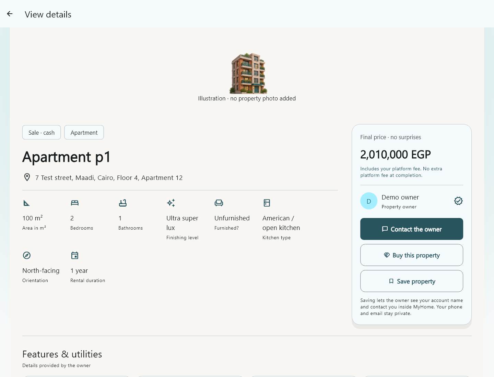
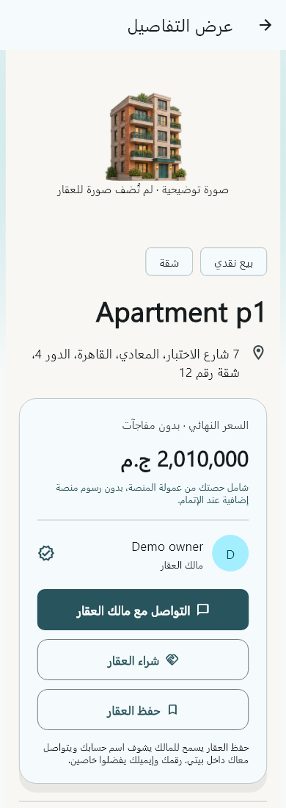
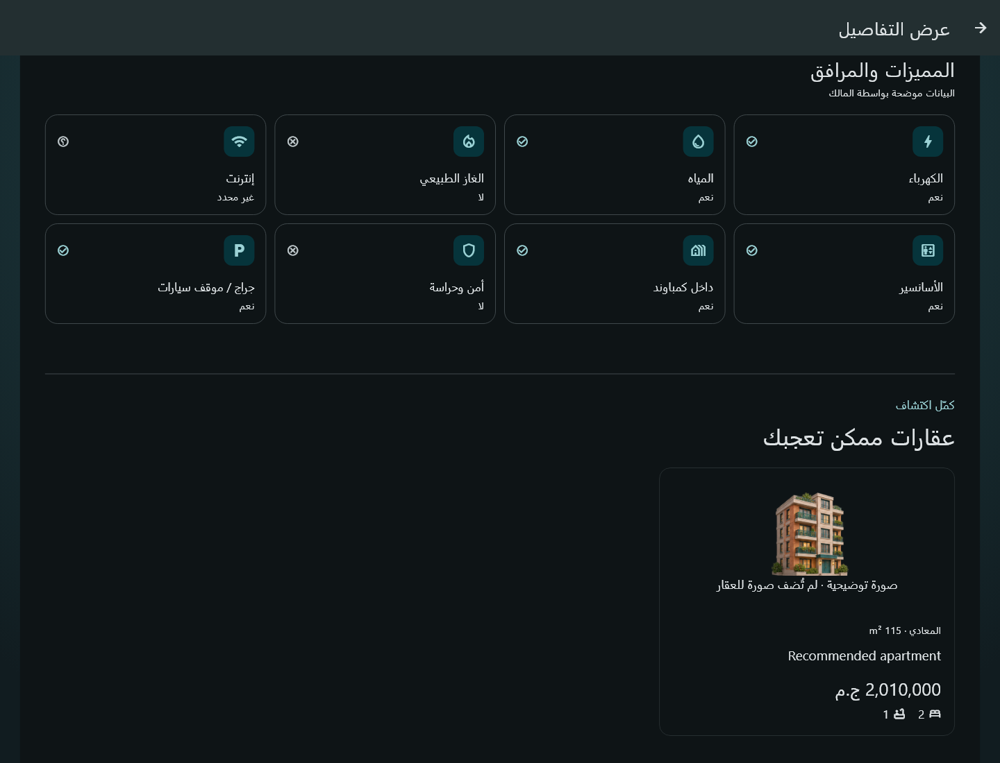
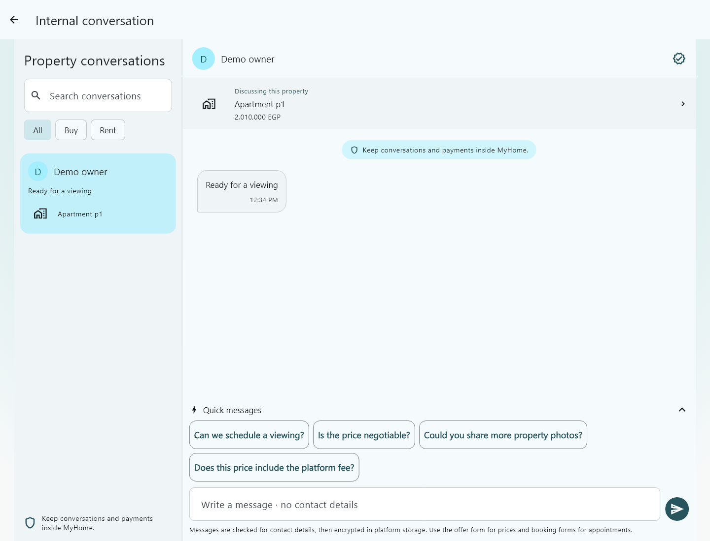

# Property experience, optional features and messages — 2026-11-16

Follow-up corrections to Home navigation, numeric inputs, identity consent/scanning and finishing artwork are in [guide 44](44_IDENTITY_VALIDATION_AND_HOME_REFINEMENTS.md). Earlier verification evidence below describes this increment; shared screenshot filenames may now show the subsequent verified presentation.

This increment follows the owner's attached desktop/mobile reference screenshots. The Figma URL was empty, so no Figma file was inspected and pixel-perfect correspondence to an unseen file is not claimed. Existing marketplace, pricing, permission, media and consent flows remain in place.

## Property presentation

- Actual property photos form a desktop mosaic and mobile swipe gallery, with an accessible full-screen viewer and zoom. Missing photos remain explicitly labelled illustrations. No synthetic interior photos are presented as listing media.
- A responsive headline/address and summary strip sit beside a final-price/contact card on desktop. Mobile places price, Contact owner, Buy/Rent and Save immediately after the heading. Financial breakdowns remain in the existing listing calculator and supervised transaction flow.
- One **Features & utilities / المميزات والمرافق** section uses consistent utility tiles for electricity, water, gas, internet, elevator, compound, security and garage. It distinguishes Yes, No and Not specified. These are owner declarations, not invented service-verification claims. Labels appear below their symbols.
- Related listings come from authenticated `GET /properties/{id}/similar`, capped at six. They use the existing approved/active/verified-owner visibility query, exclude the source, match its category, then rank same area/governorate and advertised-price proximity. Hidden sources are accessible only to their owner; recommendations never expose private addresses or owner names. Empty and retry states are supported.
- Owner-only visitor and save counts are now **inside each property card**, with eye/bookmark glyphs and adjacent numbers. The bookmark count opens the existing owner-only saver/contact list. Public cards do not receive those counts. Three-row owner pagination and unavailable/review overlays are preserved.

## Optional listing answers and persistence

New nullable fields: `compound`, `security`, `internet`, `garage` (strict booleans), `orientation` (north/south/east/west/north_south), and `kitchen_type` (closed_kitchen/american_kitchen). Every new answer may be skipped or cleared. Unknown legacy data stays NULL; it is never fabricated as No. They appear alongside the existing elevator step without adding mandatory steps. Generated copy and review show supplied answers.

`ultra_super_lux` is available in listing and discovery. Furnishing applies to Lux, Super Lux and Ultra Super Lux. Existing Red brick/Plaster rules remain. The finishing selection uses five distinct native symbols as one coherent group; existing meaningful choice pictures elsewhere are preserved.

Two additive Alembic revisions follow `20261116_address_engagement`: `20261116_optional_features` and `20261116_finish_options` (new head). They add nullable columns and extend named check constraints. No volume reset, data reseed or financial formula change. Downgrades deliberately require restoring an isolated backup rather than discarding newly captured answers.

## Messages

The property inbox has search, All/Buy/Rent filters, real participant names, latest message previews and property thumbnails. Desktop threads include an inbox sidebar; mobile uses separate inbox/thread views. Search filters loaded pages, with Load more available. Existing deal and housing-group threads remain supported.

Participant-authorized `GET /conversations/{id}` supplies real property context; inbox previews decrypt only the requesting participant's conversations. The thread uses real message timestamps, retained history/retry/send behavior and responsive bubbles. Four quick replies fill a draft and require an explicit Send press. A blocked message retains the draft and shows the existing moderation error. No fabricated online status, read receipts, unread count, attachments or nonfunctional call button is added.

Server contact inspection, rate limits and encrypted-at-rest storage remain; this is not E2EE. Source checks include outsider denials for both metadata and message reads. Existing independent contact does not automatically start a Deal.

## Verification

- **111 Flutter tests PASS**, including owner-card counters/navigation, optional answer preservation, ultra finishing/furnishing filters, protected gallery/full-screen behavior, recommendations and desktop/mobile quick-message/moderation states.
- **113 real PostgreSQL tests PASS** in the isolated test database, including financial/permission regressions, nullable feature persistence, strict validation, positive ultra furnishing search, visible recommendations and participant-only metadata/previews. One upstream Starlette/httpx deprecation warning remains.
- Flutter analyzer and Ruff are clean. **Eight render scenarios PASS**, producing 40 synthetic screenshots across Arabic/English, light/dark, 320/390px mobile and 1440px desktop. Widget-render review is not physical-device or browser-GUI verification.

## Delivery evidence

Web release and Android debug builds passed. The refreshed debug APK is `artifacts/MyHome-demo.apk` (231,601,934 bytes), configured for the stable Worker API. The launcher was interrupted while reporting its Android build, so the final APK was rebuilt through a directly tracked command; its successful result is in `artifacts/figma-android-build.log`.

Both main and demo APIs are healthy at `20261116_finish_options`. Full PostgreSQL custom-format backups were taken before migration. Pre/post checks retained all existing user/property/favorite/asset/conversation/message counts: main has two users and no properties; demo has 12 users, 15 properties, seven favorites, 11 assets, four conversations and eight messages. New optional columns remain NULL on legacy rows. No reset/reseed was performed.

The expired temporary tunnel was reconnected and the existing `myhome` Worker gateway updated (deployment version `508c7c43-03b3-413a-97ba-5736121353a9`). Actual public HTTP verification matched the latest JavaScript bundle to local SHA-256 `efc49afcf2e0281f3b47808a6f18e8a99805fd4737b6776f0d8273a3fc3d27e9`. It checked owner in-card data, existing optional/unknown detail output, the Ultra Super Lux/furnished discovery query, two actual same-category recommendations, inbox previews and property metadata. Outsider metadata/message requests returned 404, unsigned recommendations returned 401 and private configuration/artifact paths remained unavailable. This smoke only read marketplace/chat data and logged test sessions out; positive new-feature persistence and matching are verified in the isolated PostgreSQL suite.

Evidence: ignored `artifacts/figma-{analyze,flutter-tests,backend-tests,render,main-deploy,publish,android-build,public-smoke}.log`, migration before/after JSON, private dumps and the public smoke JSON. Credentials, database dumps, APK and build/runtime logs stay ignored under `artifacts/`.

The stable public URL is https://myhome.mohamed-fooda-mtf.workers.dev. It forwards to the local demo, so PC, Docker and internet must stay online. Browser GUI, physical-device/GPS and native iOS/macOS/Windows/Linux builds are not claimed. Calls, matching and the remaining production roadmap remain pending.

| Desktop detail | Mobile detail |
|---|---|
|  |  |

| Utilities | Desktop messages |
|---|---|
|  |  |
