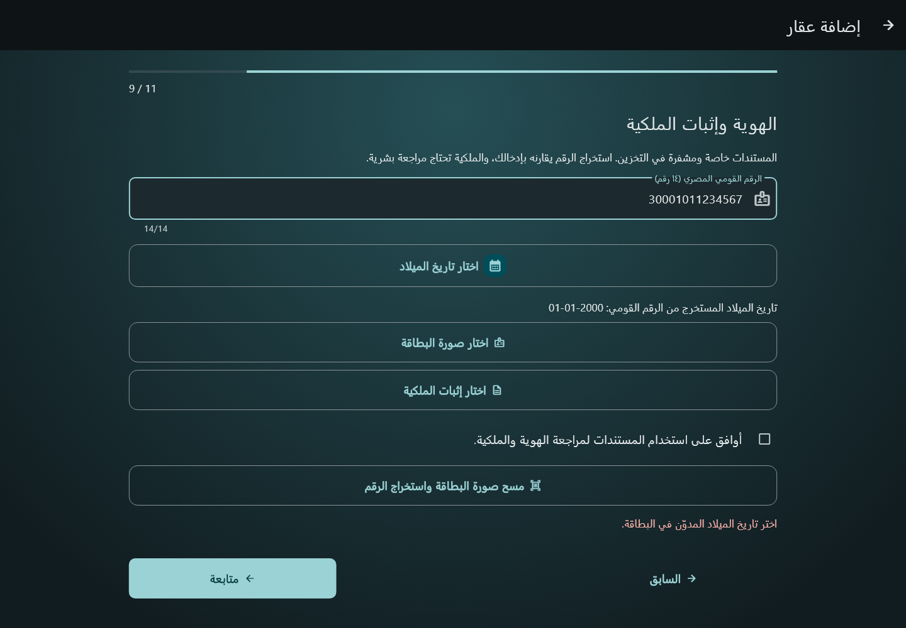
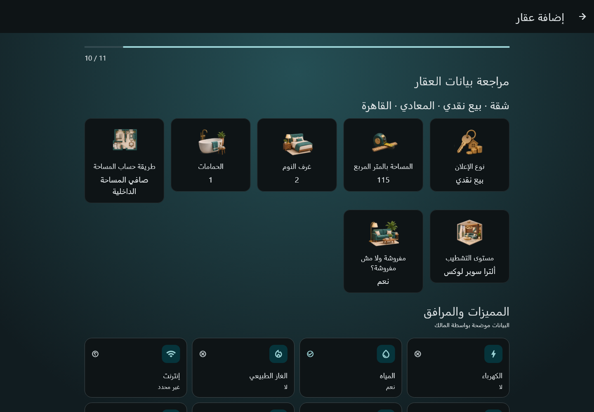
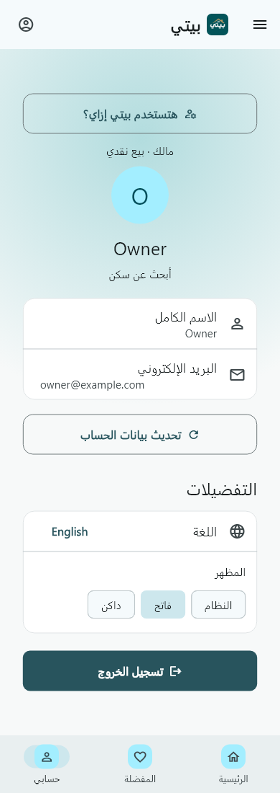
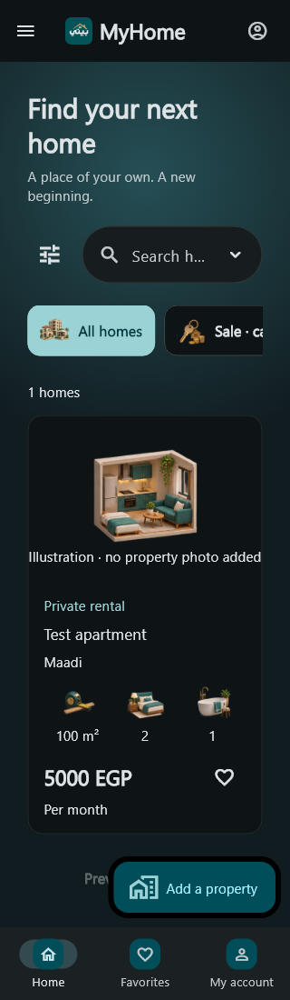

# Identity validation and home refinements — 2026-11-16

This increment implements the owner's follow-up corrections to guide 43. Existing property, pricing, conversation, map-picker and owner-counter functionality remains available.

## Navigation and numeric entry

Language switching appears only in Profile, including the guest profile. It uses a globe and a visible destination-language label. Home and authentication headers no longer contain translation controls. The home header shows Sign in for guests and an account shortcut for an authenticated user.

The current-results map control is removed from Home. The listing location picker and property-detail map remain. Quick category buttons below Search are smaller horizontal picture-and-label buttons; this is the deliberate exception to captions below pictures elsewhere.

Floor is an unsigned numeric input, not a dropdown. Ground floor is 0; newly submitted floors must be 0–100 in Flutter and FastAPI. Other listing quantity wheels are numeric inputs with common-value shortcuts and bounded plus/minus controls. Arabic/Persian digits normalize before submission, blank entries remain unanswered, and out-of-range values fail validation. No database migration or rewriting of historical floor values is required.

## Identity and consent

`core/input/egyptian_identity.dart` validates all 14 digits, supported century prefix and the encoded calendar date, including leap years and rejecting normalized impossible dates or future/today dates. The selected birth date must exactly match that encoded date. The verification step shows the encoded date, initializes the date picker from it and reports missing ID, invalid ID date, missing birth date, date mismatch, missing card photo, missing ownership document or missing consent separately.

Only identity/ownership-review consent now uses a compact native Checkbox beside its text. Other picture choice cards and the existing explicit transaction consents retain their existing selected-card presentation.

Authenticated owner-only `POST /identity/scan` accepts a card photo plus explicit review consent. It uses the existing Tesseract installation with Arabic/English recognition, grayscale/autocontrast and bounded resizing. The endpoint reads Arabic/Persian/Latin digits, including spaces between digits, requires one date-valid 14-digit candidate and returns its number and encoded birth date. It does not persist the preflight image or extracted data. Responses are `no-store`; upload size, image decoding limits and a maximum 10 scan requests/minute limiter apply. The client allows a longer response timeout for scan/document upload. The demo API now enables OCR, matching the main API.

The scan button fills empty/correct matching input and displays the extracted values. It reports a mismatch without silently replacing an existing different number/date. Unreadable, multiple-number, missing-consent and unavailable-engine cases have specific retry instructions. Final encrypted identity upload independently repeats date matching and OCR comparison; a detected number mismatch is rejected server-side. Unreadable/unavailable recognition remains explicitly subject to human document review. OCR is text extraction, not proof that an ID or ownership document is genuine; existing administrative verification remains mandatory.

## Feedback and finishing artwork

Continue reports the first invalid field or unanswered question, including individual utilities, street/building/floor/unit, area/rooms, furnishing, bed capacity and pricing requirements. Backend field-validation failures identify the field rather than becoming a generic network error. Existing financial calculation and consent rules are unchanged.

Finishing choices again use the existing coherent transparent illustration set. Ultra Super Lux has a new transparent generated cutaway-room asset at `assets/illustrations/ultra-finish-v1.png`, wired into the same artwork component so review no longer renders an empty finishing picture. Source/prompt provenance is in `design/illustrations/ULTRA_FINISH_V1.md`.

## Verification

- **115 Flutter tests PASS**, including guest/profile language placement, compact horizontal categories, absent Home map control, unsigned floor/quantity entry, exact ID/DOB validation and per-field feedback. The full Arabic/English owner wizard also scans via the test repository, confirms the sole identity Checkbox and submits successfully.
- **126 real PostgreSQL tests PASS**, including new negative-floor rejection and OCR auth/consent/non-persistence, Arabic/spaced extraction, impossible dates, ambiguous/unreadable scans, unavailable engine and independent final-upload mismatch checks. OCR output is mocked in these unit/API regressions; actual-engine release evidence is recorded separately below.
- Analyzer and Ruff clean. **Eight render scenarios PASS**: four new home/profile/listing/identity/review scenarios plus four updated address/detail/owner scenarios. They generate 60 synthetic screenshots across 320/390/1440/1920px, Arabic/English and light/dark. Widget rendering is not browser GUI or physical-device testing.

The final scan interaction also locks the form while OCR is running, so a different image/input cannot race with a pending result. Fifteen targeted wizard/identity tests passed again after this last refinement, and the final analyzer remained clean. The existing migration head remains `20261116_finish_options`; no data reset/reseed.

## Delivery evidence

The final Web release and Android debug builds passed. The current APK is `artifacts/MyHome-demo.apk` (231,613,830 bytes), configured for the stable Worker API. Both API services are healthy. The existing Worker origin was reused without changing its public address.

Actual HTTP reads through the public URL matched the final JavaScript SHA-256 `9f04c7b8194a3606692e602083153ca53235a3acbfbceedbaaa51e4d6441da62` and the new transparent Ultra PNG SHA-256 `6def4b498d8d9b42d4a45d1d989f8b28d16322ff6204a6b802f2773178083750` to local files.

Real Tesseract was exercised through the local deployed API and the public HTTPS API, using a plain image labelled SYNTHETIC OCR TEST ONLY. It extracted the synthetic 14-digit number and returned the correct encoded birth date with `no-store`, without mocking the engine. This probe is not a real identity document and does not assess authenticity. An initial public connection reset was retried; the subsequent actual extraction passed.

Public scan requests returned 401 for a guest, 403 for a non-owner and 400 for missing consent. The scan persisted no Asset. Pre/post checks retained both databases' user/property/favorite/asset/conversation/message counts and migration head. Existing demo data at this rollout included 12 users, 16 properties, seven favorites, 18 assets, four conversations and eight messages; it was not reseeded. Test sessions were logged out.

Evidence remains ignored under `artifacts/refinement-*`: analyzer/full and targeted test logs, render output, main API and final publishing logs, local OCR log, public smoke report and pre/post aggregate-count snapshots. No real ID images, credentials or database dumps are committed. The stable URL remains https://myhome.mohamed-fooda-mtf.workers.dev; PC, Docker and internet must remain online. Native iOS/desktop, browser GUI and physical-device/GPS testing are not claimed.

| Consent and precise feedback | Finishing review |
|---|---|
|  |  |

| Mobile profile | Compact Home categories |
|---|---|
|  |  |
