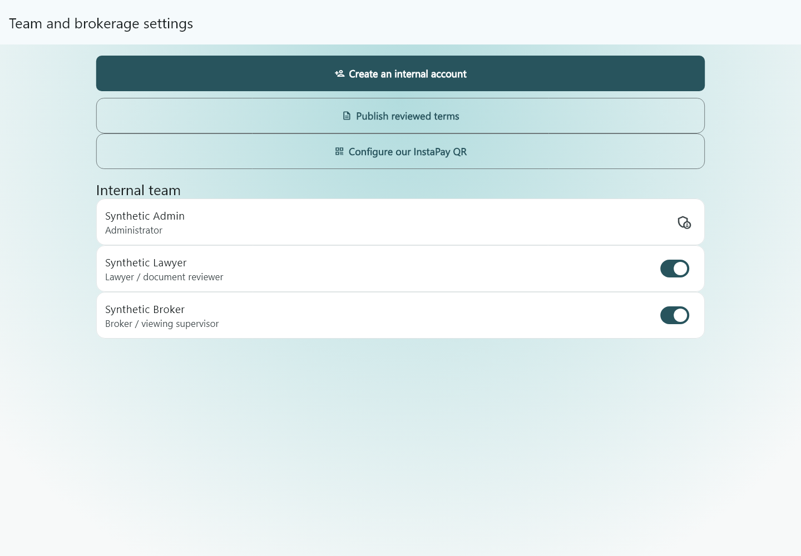

> Historical increment: fixed usernames, legacy-admin retirement and lawyer/broker-only creation in [guide 46](46_OPERATOR_DASHBOARD_GUIDES_AND_MOBILE.md) supersede the admin-bootstrap/third-admin instructions below.

# Internal administrators and mobile server launcher — 2026-11-16

## Local operator credentials

The requested private directory is `admin/`. Open **`admin/ADMIN_LOGIN.txt`** for the current Web/mobile administrator login and the separate main-database login. Machine-readable copies live in `admin/credentials.json`. This entire directory is ignored by Git, is not part of the Flutter bundle and is blocked at the Web/Worker root paths. Local Windows ACLs grant access to the current user, SYSTEM and Administrators; credentials are never printed in logs or committed.

`tools/prepare_admin.py` reuses a known active administrator only after verifying its stored password. It never resets a password, promotes an ordinary existing user or changes ownership verification. If no known usable operator login exists, it creates a separate admin with a random password and an audit event. Repeating the tool reuses the same credentials. An existing unknown password cannot be recovered from its hash.

Actual setup created one administrator in `myhome` while preserving the two existing users, and reused the existing demo administrator in `myhome_demo` without adding a user. Two consecutive setup runs passed. Fingerprints confirm every pre-existing user's name/email/password hash/role/active/verification/onboarding fields stayed unchanged, as did property/media/favorite/conversation/message/staff counts and migration heads. Private setup evidence remains under ignored `artifacts/`.

Run manually, with PostgreSQL already online, if setup is needed again:

```powershell
backend_fastapi/.venv/Scripts/python.exe tools/prepare_admin.py
```

## Internal account creation

Sign in as admin, then open **القائمة الجانبية → الفريق وإعدادات الوساطة → إنشاء حساب داخلي**. Choose Administrator, Lawyer / document reviewer, or Broker / viewing supervisor. Enter name, email and a strong initial password of at least 12 characters (maximum bcrypt input 72 bytes). A lawyer also requires a professional reference supplied and checked by the operator.

The existing `/admin/staff` endpoint and Flutter repository/form are extended rather than duplicated. Only a currently active authenticated administrator may create/list accounts. An admin account receives the existing full administrator authority and no StaffMember row; lawyers and brokers receive the existing document_reviewer/field_agent profile with normal user role. A new admin can create another admin. Neither a public signup nor a lawyer/broker can grant admin authority. Created accounts complete internal onboarding and do not automatically become verified property owners. Duplicate emails return 409, and account creation is audited. Responses/listings contain no password hashes or passwords.

The existing staff enable/disable control applies to lawyer/broker authority. Admin rows show a shield instead of that switch, so this page cannot accidentally disable an administrator through a staff endpoint. Legal-document access remains limited to assigned reviews and viewing work to assigned brokers. Financial and document approval rules are unchanged. Entering a professional reference is not automatic accreditation.

## Mobile startup without a connected device

Double-click **`Start_MyHome_Mobile.cmd`**. It invokes the shared launcher with `-Mobile -NoBrowser`:

- Starts Docker Desktop if needed, PostgreSQL and the existing demo API/database.
- Preserves existing accounts/listings and skips demo seeding when accounts already exist.
- Skips Flutter pub/build, APK compilation, installation, emulator and ADB/USB discovery.
- Starts the existing Web/API reverse proxy and public tunnel, reconnecting the configured stable Cloudflare Worker.
- Prints **MOBILE API** with `/api/v1` and the Web/share URL. Existing Web files and APK are retained.

The installed current APK already uses the stable Worker URL, so it can connect from another network after the server is online. The phone does not need to be attached to the computer. Keep the PC, Docker and internet online. Docker/Python are required; the stable Worker launcher also uses the configured Node/Wrangler setup. Flutter/Android SDK are needed only for an explicitly requested rebuild, not normal mobile-server startup.

Use `Stop_MyHome.cmd` to stop the demo API/sharing; PostgreSQL stays running and data is preserved. To build a fresh APK use the existing `Start_MyHome.cmd -Android -NoBrowser`. Mobile-server startup reuses existing Web files; if they have never been built, the API still starts, while Web testing needs a normal Web build first.

## Verification

**121 Flutter tests PASS**, **137 real PostgreSQL tests PASS**, clean analyzer/Ruff, **11 Worker tests PASS** and PowerShell syntax parsing PASS. New cases verify all three creation roles in Arabic/English, secondary admin authority, guest/non-admin denial, strict input and professional-reference validation, duplicate email safety and bootstrap reuse without account modification. Four render scenarios produce 12 synthetic desktop/mobile AR/EN light/dark previews. No real credentials appear in screenshots. Delivery/runtime evidence is appended after publishing.

No schema migration, account reset or marketplace-phase completion. Current migration head remains `20261116_finish_options`. Calling, matching and outstanding production work remain pending; physical-device and native iOS/desktop testing is not claimed.

| Roles on mobile | Internal team |
|---|---|
|  |  |

## Verified delivery of increment 45

Web release and Android debug were built; both APIs and the stable Worker were updated. The mobile launcher passed with Flutter paths removed, no attached device/build/ADB. Final HTTP smoke confirmed main/demo admin access, guest 401/ordinary 403, private admin-root 404 and public Web hash parity. APK size was 231,615,545 bytes. Evidence: ignored artifacts/admin-public-smoke.json and admin-mobile-start.log. These are historical delivery checks; guide 46 records the newer account model.
