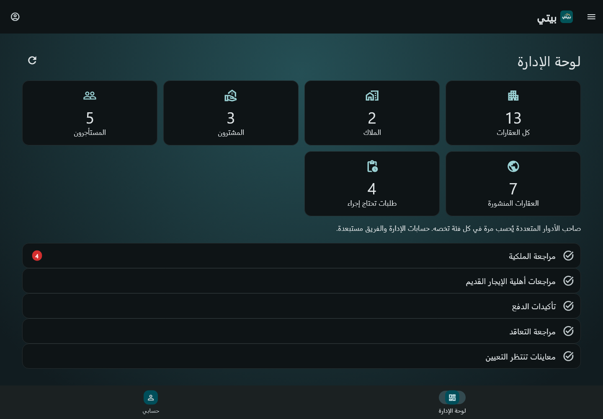

> Visual amendment: [guide 47](47_ARCHITECTURAL_HEADERS_AND_GUIDE_POSES.md) replaces repeated presenter pairs with alternating individual poses and adds architectural headers. Account/security behavior below is retained.

# Operator dashboard, fixed accounts and illustrated guides — 2026-11-17

## Accounts and permissions

Only **fooda** and **amr** are administrators, independently in main and demo. They sign in using the username instead of email. The API retains the `email` request key for compatibility with existing clients; public registration and staff creation still require email. Administrator email login is rejected. Admins cannot select owner intents or create listings, even through direct HTTP requests or retained owner intents.

The previous “create another administrator” requirement in guide 45 is superseded. The internal team form now creates only lawyer/document_reviewer and broker/field_agent profiles. Creating a third admin through signup or `/admin/staff` is rejected.

`tools/prepare_admin.py` takes PostgreSQL custom-format backups of **both** databases before schema/account mutations, applies the additive migration, durably saves random initial passwords, then reconciles the two accounts. Existing chosen passwords are preserved on repeat runs. Previous admin records become inactive ordinary accounts and their sessions are revoked; their IDs, documents, property ownership, messages and audit references remain intact. No database reset/reseed or cascading user deletion is used.

Credentials are local only: **`admin/ADMIN_LOGIN.txt`**, `admin/operators.json` and compatibility `admin/credentials.json`. Windows ACLs restrict the folder; Git ignores it, and Caddy/Worker reject `/admin` root paths. Passwords/tokens are not printed or included in screenshots. Initial passwords become obsolete after the user changes them.

Actual provisioning: main retained its three existing users and added two operators; demo retained its 12 existing users and added two operators. All marketplace table counts and pre-existing name/email/password/ownership/onboarding fingerprints remained unchanged. Only previous admin authority/active flags changed as requested. Evidence: ignored `artifacts/operator-preservation-report.json`. Migration head is now **`20261116_fixed_admins`** in main/demo; the new nullable unique username column preserves legacy rows.

## Dashboard and passwords

Admin Home opens the dashboard. Favorites, My properties, Housing groups, Property conversations and Add property are absent from admin navigation. Normal user navigation remains available for their roles.

The dashboard counts all properties, published properties, active owners, buyers and tenants. Multiple intents count a person once per relevant category; categories can overlap. Staff/admin accounts are excluded from marketplace people counts. Pending ownership/legal reviews, payment claims, contracts and unassigned confirmed viewings have red numeric badges. Counts refresh on opening the drawer, after dashboard queue navigation and every 30 seconds; failures show unknown counts and retry instead of invented zero statistics.

Every signed-in user has Profile → Change password. The server checks the old password, validates the new value, rejects reuse, revokes other sessions and audits the change. The current session remains available. User-first locks serialize password changes and login; concurrent changes cannot both accept the same old password. Email OTP recovery is not implemented. Admins use this same old/new password flow.

## Introduction, guide and About

The supplied two presenter characters are recreated together as a transparent illustration in `assets/illustrations/guide-duo-v1.png`. The first-run introduction explains discovery, listing and supervised contact, with swipe/Next/Skip, reduced-motion support and a persisted completion preference. The introduction can be replayed from the user guide/About.

Guide/About explain current role choices, automatic listing copy, complete address, photos, optional map pin/features, final-price calculator, national-ID/DOB checks and human document review, internal messaging, viewings and supervised deals. Calls and roommate matching remain explicitly pending. Server-moderated encrypted storage is described accurately; no E2EE claim is made. Area-data licensing stays in About. Presenter source/provenance is recorded in `design/illustrations/GUIDE_DUO_V1.md`.

## Physical-phone connection

The native default API now uses **`https://myhome.mohamed-fooda-mtf.workers.dev/api/v1`** instead of Android-emulator-only `10.0.2.2`. Web uses same-origin `/api/v1`. An explicit `--dart-define=API_BASE_URL=...` still overrides either default.

Run **`Start_MyHome_Mobile.cmd`** to start PostgreSQL/API/public sharing without a connected phone, Flutter build, ADB or emulator. Keep PC/Docker/internet online. Older installed apps with an emulator/localhost endpoint require rebuilding/reinstalling; starting the backend alone cannot change an endpoint compiled into an old APK. For local emulator-only work use `--dart-define=API_BASE_URL=http://10.0.2.2:3000/api/v1` explicitly.

## Verification

- **130 Flutter tests PASS**, analyzer clean; admin navigation, password errors, first-run persistence/Skip/steps, dashboard retry and native HTTPS defaults covered.
- **142 real PostgreSQL tests PASS**, including fixed admin reconciliation, old-login rejection, third-admin denial, password revocation/concurrency and actual aggregate state changes.
- **11 Worker tests PASS**, Ruff clean; 12 pure schema acceptance/rejection checks and PostgreSQL DDL/Python compilation pass.
- Four responsive render scenarios produce 20 synthetic AR/EN light/dark phone/desktop previews. Selected images were inspected for layout and presenter transparency.
- Runtime build/public delivery evidence is appended after verification below. Physical-device GUI, native iOS and desktop runner execution are not claimed.

| Introduction | Dashboard |
|---|---|
|  |  |

## Actual delivery of increment 46

Main/demo APIs were rebuilt and healthy. Web release and Android debug were published through the stable Worker gateway. Actual HTTP checks passed for fooda/amr username login on both environments, rejection of legacy admin/email logins and third-admin creation, guest/ordinary dashboard denial and private-root 404. A real newly created main operator password was changed and restored after confirming the current session survives and the second session is revoked. No pre-existing user password was changed. Public Web hash matched local output; APK included guide artwork. Evidence: ignored artifacts/operator-public-smoke.json. Existing HTTP demo smoke also passed for chat/group isolation, staff, portfolio pages, favorite states and all-in fees.
