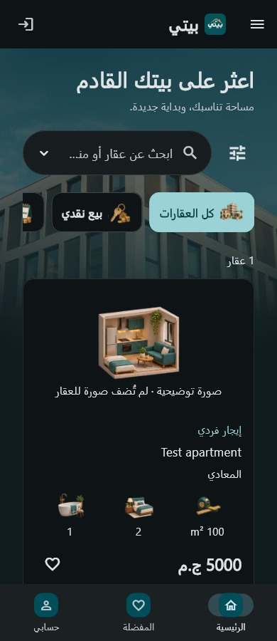
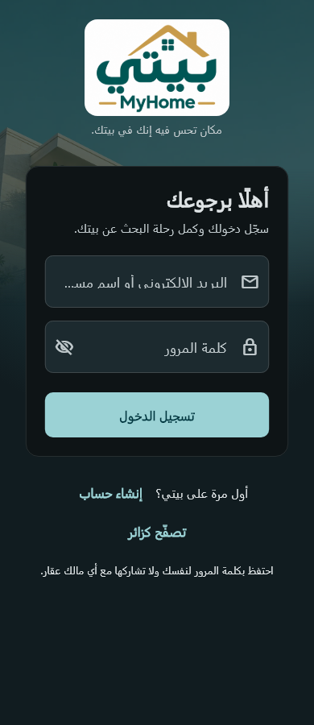
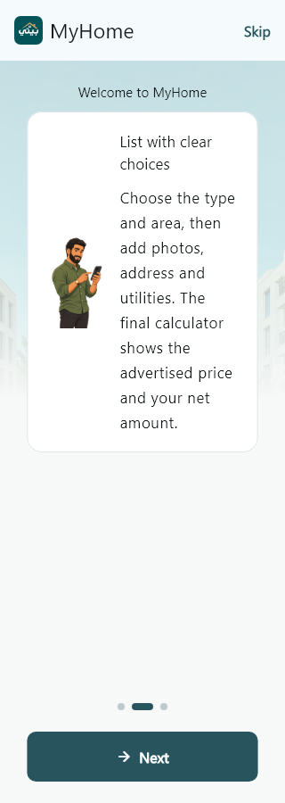

# Architectural headers and alternating presenters — 2026-11-17

## Visual assets and integration

Three architectural background photographs were generated with the built-in imagegen tool from the user's visual direction: cream/dark window building corner against teal sky, stepped residential balconies and an open courtyard. They are decorative fictional scenes, separate from actual listing photos. Files live in `myhome_flutter/assets/backgrounds/` as local WebP assets; no image API is called by the app. Exact prompts and provenance are in [design/visuals](../design/visuals/README.md).

Shared `AppScaffold` now renders a theme-tinted architectural header behind the first part of each normal application page. Home uses the corner scene; login/registration, listing and password pages use balconies; the remaining screens use the courtyard or their explicitly selected companion. Profile, marketplace results, owner listings, admin, deals, groups, forms and support inherit the shared component. The fullscreen listing-photo viewer retains the actual property photos.

The header preserves existing content/control positions and the current teal palette. Its height adapts to the viewport and fades into the existing canvas. Different light/dark tints preserve text contrast. The decorative layer has no semantics, focus or pointer targets and uses bundled files with a graceful theme-color fallback. Real images, maps and content cards keep their own surfaces.

## Presenter rules

The two supplied characters appear together **only on the first introduction page**. Four new transparent poses preserve each character's identity and outfit: olive-shirt presenting/phone demonstration; taupe-blazer explanation/document folder. All are real generated illustrations, compressed without changing their composition.

Later introduction pages display one character beside its explanation. Guide and About display one character for every section, alternating olive/blazer/olive/blazer through the content. Caption text stays beside the presenter as specifically requested here. Other property picture/caption rules remain unchanged. Widths adapt to phones and desktop; images reserve their dimensions to avoid layout shifts while decoding. Brief entrance motion honors system reduced-motion preference; page advancement uses an immediate jump when animations are disabled.

The About and guide copy describes existing discovery, role/listing choices, verification, fees, viewings and messages. No pending calling/matching or automated legal guarantees are advertised as complete.

## Validation and delivery

Current tests and delivery evidence are appended below after completion. No backend schema/pricing/permissions change is introduced by this visual increment. Main/demo remain on `20261116_fixed_admins` with the two fixed admin usernames from [guide 46](46_OPERATOR_DASHBOARD_GUIDES_AND_MOBILE.md). No reset/reseed.

| Home | Login | Individual explanation |
|---|---|---|
|  |  |  |

## Verified results

**142 Flutter tests PASS**, analyzer/Ruff clean. Four render scenarios (1440 desktop and 390/320 phone, Arabic/English, dark/light) produce 32 previews covering Home, login, introduction, both individual presenter pages, guide/scrolled guide and About. Selected raw assets and rendered pages were visually inspected. Tests verify bundled offline assets, unobstructed controls, deterministic alternating presenters, adjacent mobile layout and reduced-motion advancement. Existing **142 PostgreSQL** and **11 Worker** tests remain passing; seven targeted backend/security tests also passed after the final password rate-limit update from increment 46.

Web release and Android debug were built and published through **https://myhome.mohamed-fooda-mtf.workers.dev**. Public health passed, and downloaded `main.dart.js` matches the local build SHA-256 `959726582ca5db98db6fcd942630f86dbf96f7b836c7c4e8705628065186fa33`. All seven new background/presenter assets match the source bytes both through the public Worker URL and inside the APK. Final APK: ignored `artifacts/MyHome-demo.apk`, **231,654,708 bytes**. Evidence: ignored `artifacts/visual47-public-smoke.json`, `architecture-publish.log`, `architecture-flutter-tests.log` and `architecture-final-render.log`. The previous Web output is archived locally under ignored `artifacts/web-before-visual47/`.

The mobile API launcher uses the same stable HTTPS URL without a connected device. Physical-device GUI interaction, native iOS and desktop runner builds are not claimed. Keep the PC, Docker and internet online for the local API behind the Worker. Install the current APK when replacing an older build configured with an emulator/localhost URL.

Actual `Start_MyHome_Mobile.cmd <NUL` execution passed after the final build: PostgreSQL/demo API/Caddy were healthy, the Worker connection was reused, and the stable MOBILE API was printed without a Flutter build, ADB or connected phone. Evidence: ignored `artifacts/visual47-mobile-launch.log`.
